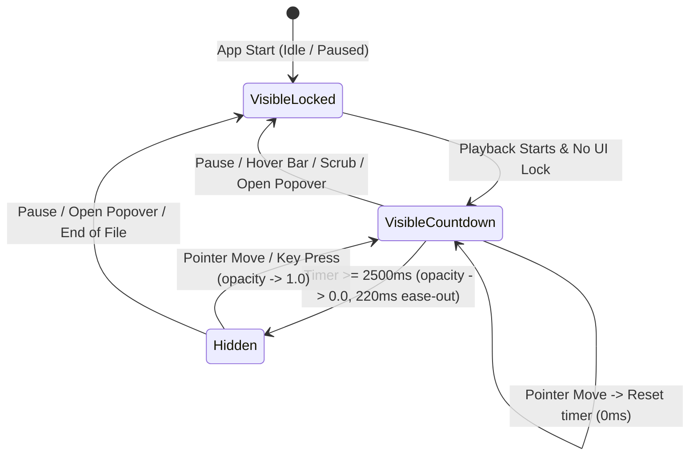
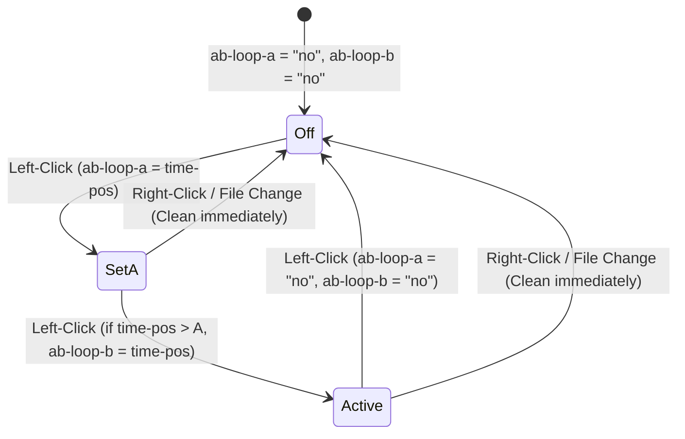

# Main Media Controls — UI, Styling & Technical Implementation Specification

> **Document Status:** `AS_BUILT` (Implemented & Verified)  
> **Post-Implementation Target:** Verified all acceptance criteria and test matrices in [Section 11](#11-as-built-verification-checklist-post-implementation) across 14 automated Catch2 unit and headless Slint UI test suites.

This specification defines the **Main Media Controls** overlay UI and its end-to-end **C++26 (`libmpv`) ↔ Slint 1.19** technical architecture for **mpvx**. It serves as both the implementation blueprint and the future **As-Built** reference documentation.

---

## 1. Key Style Rules

1. **Frameless, Rounded Full-Bleed Canvas (`no-frame: true`):**
   - Hide OS window decorations via `no-frame: true;` and `background: transparent;` on `MainWindow inherits Window` (`ui/app-window.slint`).
   - Wrap the window contents in a clipped `window-shell` (`border-radius: 12px` when windowed, `0px` when maximized or fullscreen, with a subtle `1px` `#ffffff1a` border ring) over a `#000000` background.
   - The top bar background acts as the window drag handle; double-clicking the top bar toggles maximize, and double-clicking the video toggles fullscreen.
2. **Edge-Anchored Black-to-Transparent Gradients:**
   - Controls float over the video inside top and bottom linear gradients rather than solid bars or boxed cards.
   - **Top Gradient (`height: 64px`):** `@linear-gradient(180deg, #000000bf 0%, #00000059 55%, #00000000 100%)`
   - **Bottom Gradient (`height: 104px`):** `@linear-gradient(0deg, #000000d9 0%, #00000073 55%, #00000000 100%)`
3. **Fade-In / Fade-Out Circular Button Backgrounds:**
   - Every icon control uses a `34px × 34px` circular hit target (`border-radius: 17px`) with a smooth background fade (`150ms ease-in-out`):
     - **Idle:** `#ffffff00` (transparent)
     - **Hover:** `#ffffff26` (15% white)
     - **Pressed:** `#ffffff40` (25% white)
     - **Active / Toggled:** `#ffffff33` (20% white)
4. **Smooth HUD & Micro-Interaction Motion:**
   - **HUD Auto-Hide:** Top and bottom overlays fade (`opacity` `1.0 ↔ 0.0`, `220ms ease-out`) after `2.5s` of pointer inactivity during playback; always visible when paused, idle, hovering controls, scrubbing, or when a popover is open.
   - **Seek Bar:** Slim `3px` track expands to `5px` on hover (`120ms ease-out`), with a `12px → 14px` white scrubber thumb.
   - **Popovers:** Dark glass surface (`#12141ae6`, `1px` border `#ffffff1f`, `border-radius: 10px`) fading and sliding `6px → 0px` (`150ms ease-out`).
5. **Monochrome-First Hierarchy:**
   - Primary icons and progress fill are crisp `#ffffff`; secondary icons `#ffffff99`; disabled controls `#ffffff40`.
   - Subtle `#818cf8` accent is reserved for active A/B loop markers on the timeline and active loop indicators.

---

## 2. Color & Metric Tokens (`ui/theme.slint`)

| Token | Type | Value | Usage |
| :--- | :--- | :--- | :--- |
| `canvas-bg` | `color` | `#000000` | Window & video viewport background |
| `window-border` | `color` | `#ffffff1a` | 1px subtle border ring on rounded frameless window shell |
| `window-radius` | `length` | `12px` | Corner radius for frameless window shell (`0px` when maximized/fullscreen) |
| `hud-gradient-top` | `brush` | `@linear-gradient(180deg, #000000bf 0%, #00000059 55%, #00000000 100%)` | Top overlay gradient |
| `hud-gradient-bottom` | `brush` | `@linear-gradient(0deg, #000000d9 0%, #00000073 55%, #00000000 100%)` | Bottom overlay gradient |
| `popover-bg` | `color` | `#12141ae6` | Track / Open / Settings / Chapter popovers |
| `popover-border` | `color` | `#ffffff1f` | 1px popover border |
| `popover-item-hover` | `color` | `#ffffff14` | Popover list item hover background |
| `popover-item-active` | `color` | `#818cf826` | Popover selected item background |
| `btn-circle-idle` | `color` | `#ffffff00` | Circular button resting background |
| `btn-circle-hover` | `color` | `#ffffff26` | Circular button hover background |
| `btn-circle-pressed` | `color` | `#ffffff40` | Circular button pressed background |
| `btn-circle-active` | `color` | `#ffffff33` | Circular button toggled-on background |
| `icon-primary` | `color` | `#ffffff` | Primary icon tint |
| `icon-muted` | `color` | `#ffffff99` | Secondary icon tint |
| `icon-disabled` | `color` | `#ffffff40` | Disabled icon tint |
| `icon-accent` | `color` | `#818cf8` | Active A/B loop / timeline markers |
| `text-primary` | `color` | `#f8fafc` | Title & primary labels (`13px`, weight `500`) |
| `text-secondary` | `color` | `#e2e8f0` | Time readout (`12px`, weight `500`, `0:00 \| 43:02`) |
| `text-muted` | `color` | `#94a3b8` | Subtitle / metadata / empty state text |
| `seek-track` | `color` | `#ffffff38` | Unplayed seek track |
| `seek-fill` | `color` | `#ffffff` | Played seek fill & thumb |
| `seek-ab-fill` | `color` | `#818cf84d` | Highlighted region between A and B markers |

### Geometry & Animation Tokens
- **Top Gradient Container Height:** `64px` (Interactive bar content height: `56px`, `16px` horizontal padding)
- **Bottom Gradient Container Height:** `104px` (Interactive bar content height: `96px`, `18px` horizontal padding, `14px` bottom padding, `8px` gap between control row and seek row)
- **Circular `IconButton`:** `34px × 34px` (`border-radius: 17px`), `18px × 18px` centered SVG, `6px` gap between buttons
- **Seek Bar Hit Target:** `20px` tall interactive container centering the `3px` (idle) / `5px` (hover/scrub) visual track
- **Inline Volume Drawer:** Expands horizontally from `0px` to `76px` (`150ms ease-out`) when hovering the volume button or dragging the volume slider

---

## 3. Main Media Controls & Actions

### Top Overlay Bar (`ui/components/top-bar.slint`)
| Region | Control | Lucide Icon | Slint Callback / Action | `libmpv` / Window Mapping |
| :--- | :--- | :--- | :--- | :--- |
| Left | **Open Menu** | `folder-open` + `chevron-down` | Toggles `ActivePopover.OpenMenu` (`open-file-clicked()`, `open-url-submitted(string)`) | `Player::load_file(path)` (`loadfile <path> replace`) |
| Center | **Media Title** | — | Displays `media-title` (`overflow: elide`); drag area (`window-drag-requested(dx, dy)`); double-click (`maximize-toggled()`) | `media-title` property; `Window::set_position()`, `Window::set_maximized()` |
| Right | **Menu** | `menu` | Toggles `ActivePopover.AppMenu` (Media Info, Shortcuts) | Reads observed video/audio codec & resolution info |
| Right | **Minimize** | `minus` | `minimize-clicked()` | `main_window->window().set_minimized(true)` |
| Right | **Maximize** | `square` / `copy` | `maximize-toggled()` | `main_window->window().set_maximized(!is_maximized)` |
| Right | **Close** | `x` | `close-clicked()` | `slint::quit_event_loop()` + clean `renderer`/`player` shutdown |

### Bottom Overlay Bar — Row 1 (`ui/components/controls.slint`)
| Cluster | Control | Lucide Icon | Slint Callback / Action | `libmpv` Property / Command Mapping |
| :--- | :--- | :--- | :--- | :--- |
| Left | **Previous** | `skip-back` | `prev-clicked()` | `Player::playlist_prev()` (`playlist-prev` or `seek 0 absolute+exact` if `playlist-pos <= 0` or `time-pos > 3.0`) |
| Left | **Play / Pause** | `play` / `pause` | `play-pause-clicked()` | `Player::toggle_pause()` (`cycle pause`) |
| Left | **Next** | `skip-forward` | `next-clicked()` | `Player::playlist_next()` (`playlist-next`) |
| Left | **Volume** | `volume-2` / `volume-1` / `volume-x` | Click: `mute-toggled()`; Hover/Drag: `volume-changed(float)` (`0–100%`, wheel up to `150%`) | `Player::set_mute(bool)` (`mute` flag), `Player::set_volume(double)` (`volume` double) |
| Left | **Caption Selector** | `captions` / `captions-off` | Toggles `ActivePopover.Subtitles`; `subtitle-track-selected(int)`, `load-external-subtitle-clicked()` | `Player::set_subtitle_track(id)` (`sid` = `<id>` or `"no"`), `Player::add_subtitle_file(path)` (`sub-add <path> select`) |
| Left | **Audio Selector** | `audio-lines` | Toggles `ActivePopover.Audio`; `audio-track-selected(int)` | `Player::set_audio_track(id)` (`aid` = `<id>`) |
| Right | **A/B Loop** | Custom `ab-loop.svg` | Left-click: `ab-loop-cycled()`; Right-click: `ab-loop-cleared()` | `Player::cycle_ab_loop()` / `Player::clear_ab_loop()` (`ab-loop-a`, `ab-loop-b` double seconds or `"no"`) |
| Right | **Loop** | `repeat` / `repeat-1` | `loop-mode-cycled()` | `Player::set_loop_mode(LoopMode)`: **Off** (`loop-file="no"`, `loop-playlist="no"`), **File** (`loop-file="inf"`), **Playlist** (`loop-playlist="inf"`) |
| Right | **Playlist / Chapters** | `list-video` | Toggles `ActivePopover.Chapters`; `chapter-selected(int)` | `Player::set_chapter(index)` (`chapter` int64 property or `seek <time> absolute+exact`) |
| Right | **Settings** | `settings` | Toggles `ActivePopover.Settings`; `speed-changed(float)`, `hwdec-changed(string)`, `aspect-changed(string)` | `Player::set_speed(double)` (`speed`), `Player::set_hwdec(sv)` (`hwdec`), `Player::set_aspect_override(sv)` (`video-aspect-override`) |
| Right | **Fullscreen** | `maximize-2` / `minimize-2` | `fullscreen-toggled()` | `main_window->window().set_fullscreen(!is_fullscreen)` |

### Bottom Overlay Bar — Row 2 (`ui/components/seek-bar.slint`)
- **Seek Bar:** Full-width interactive slider (`seek-requested(float)` in `0.0..1.0`) with A/B range markers (`ab-a-norm`, `ab-b-norm`) and chapter tick marks.
- **Time Readout:** Right-aligned `0:00 | 43:02` (`12px`, `font-weight: 500`, `color: Theme.text-secondary`, tabular formatting via `format_time_readout(pos, dur)`).

---

## 4. SVG Icon Standard: Lucide Icons (Locked In)

- **Source:** [Lucide Icons](https://lucide.dev) (**ISC License**)
- **Grid & Stroke Spec:** `24×24` `viewBox`, `2px` stroke width, `stroke-linecap="round"`, `stroke-linejoin="round"`, `fill="none"`.
- **Asset Location:** `ui/assets/icons/*.svg` (automatically compiled/embedded by `slint_target_sources` in `CMakeLists.txt`).

### Required SVG Inventory (`ui/assets/icons/`)
| Filename | Usage |
| :--- | :--- |
| `play.svg`, `pause.svg` | Play / Pause toggle button & central idle state |
| `skip-back.svg`, `skip-forward.svg` | Previous / Next track or chapter |
| `volume-2.svg`, `volume-1.svg`, `volume-x.svg` | Volume `>= 50%`, `1..49%`, and Muted / `0%` |
| `captions.svg`, `captions-off.svg` | Subtitle selector (active subtitle vs `sid == "no"`) |
| `audio-lines.svg` | Audio track selector |
| `ab-loop.svg` | Custom A/B loop control (authored on 24×24, 2px stroke grid) |
| `repeat.svg`, `repeat-1.svg` | Loop Off / Loop Playlist (`repeat`) vs Loop Single File (`repeat-1`) |
| `list-video.svg` | Chapters / Playlist drawer |
| `settings.svg` | Quick Settings popover (Speed, HWDEC, Aspect Ratio) |
| `maximize-2.svg`, `minimize-2.svg` | Enter / Exit Fullscreen |
| `folder-open.svg`, `chevron-down.svg`, `link.svg` | Top-left Open button & menu items |
| `menu.svg`, `minus.svg`, `square.svg`, `copy.svg`, `x.svg` | Top-right App Menu and Window controls |
| `check.svg` | Active selection checkmark inside popovers |

### Custom `ui/assets/icons/ab-loop.svg` Source
```xml
<svg xmlns="http://www.w3.org/2000/svg" width="24" height="24" viewBox="0 0 24 24" fill="none" stroke="#000000" stroke-width="2" stroke-linecap="round" stroke-linejoin="round">
  <path d="M17 2l4 4-4 4"/>
  <path d="M3 11v-1a4 4 0 0 1 4-4h14"/>
  <path d="M7 22l-4-4 4-4"/>
  <path d="M21 13v1a4 4 0 0 1-4 4H3"/>
  <text x="8.5" y="14.5" font-family="sans-serif" font-size="6.5" font-weight="700" fill="#000000" stroke="none">A·B</text>
</svg>
```
*(Note: If `resvg` in Slint ignores `<text>` nodes in embedded SVGs, represent `A` and `B` or bracket markers as `<path>` strokes on the same `24×24` grid: e.g., left/right vertical range brackets `M4 7v10` and `M20 7v10` with loop arrows between them.)*

### Slint `colorize` Rule
Set `stroke="#000000"` in each SVG file (replace `stroke="currentColor"`) so Slint's internal SVG rasterizer + `colorize` brush tints icons deterministically:
```slint
Image {
    source: root.icon;
    width: 18px;
    height: 18px;
    colorize: !root.enabled ? Theme.icon-disabled
            : root.accent ? Theme.icon-accent
            : root.muted ? Theme.icon-muted
            : Theme.icon-primary;
    animate colorize { duration: 150ms; easing: ease-in-out; }
}
```

---

## 5. Slint UI Component Architecture & Contracts

### 5.1 File Decomposition
```text
ui/
├── app-window.slint              # MainWindow (no-frame: true, FocusScope, HUD timer, popovers)
├── theme.slint                   # Theme global singleton + shared enums/structs
├── assets/
│   └── icons/*.svg               # 24x24 2px stroke Lucide SVGs + ab-loop.svg
└── components/
    ├── icon-button.slint         # Reusable 34x34 circular button with fade animation
    ├── top-bar.slint             # Top 64px gradient overlay (Open menu, drag title, window btns)
    ├── controls.slint            # Bottom 104px gradient overlay (Row 1 controls + Row 2 timeline)
    ├── seek-bar.slint            # Expanding 3px->5px seek track, thumb, A/B markers, chapter ticks
    ├── popovers.slint            # Glassmorphic popover cards (Tracks, Settings, Chapters, Open URL)
    └── video-view.slint          # Full-bleed #000000 video canvas + double-click fullscreen TouchArea
```

### 5.2 Shared Slint Types (`ui/theme.slint`)
```slint
export enum LoopMode {
    Off,
    File,
    Playlist,
}

export enum AbLoopState {
    Off,
    SetA,
    Active,
}

export enum ActivePopover {
    None,
    OpenMenu,
    OpenUrlModal,
    Subtitles,
    Audio,
    Chapters,
    Settings,
    AppMenu,
}

export struct TrackItem {
    id: int,
    title: string,
    lang: string,
    codec: string,
    selected: bool,
}

export struct ChapterItem {
    index: int,
    title: string,
    time-text: string,
    norm-pos: float, // 0.0 .. 1.0
    current: bool,
}
```

### 5.3 Reusable `IconButton` Component (`ui/components/icon-button.slint`)
```slint
import { Theme } from "../theme.slint";

export component IconButton inherits Rectangle {
    in property <image> icon;
    in property <bool> enabled: true;
    in property <bool> active: false;
    in property <bool> accent: false;
    in property <bool> muted: false;
    in property <bool> accept-scroll: false;
    in property <string> tooltip: "";
    out property <bool> has-hover <=> touch.has-hover;

    callback clicked();
    callback right-clicked();
    callback scrolled(float);

    width: 34px;
    height: 34px;
    border-radius: 17px;

    // Accessibility & testing metadata
    accessible-role: button;
    accessible-label: root.tooltip;
    accessible-enabled: root.enabled;
    accessible-checkable: true;
    accessible-checked: root.active;
    accessible-action-default => {
        if (root.enabled) {
            root.clicked();
        }
    }

    background: !root.enabled ? Theme.btn-circle-idle
              : touch.pressed ? Theme.btn-circle-pressed
              : touch.has-hover ? Theme.btn-circle-hover
              : root.active ? Theme.btn-circle-active
              : Theme.btn-circle-idle;

    animate background { duration: 150ms; easing: ease-in-out; }

    Image {
        source: root.icon;
        width: 18px;
        height: 18px;
        x: (parent.width - self.width) / 2;
        y: (parent.height - self.height) / 2;
        colorize: !root.enabled ? Theme.icon-disabled
                : root.accent ? Theme.icon-accent
                : root.muted ? Theme.icon-muted
                : Theme.icon-primary;
        animate colorize { duration: 150ms; easing: ease-in-out; }
    }

    touch := TouchArea {
        enabled: root.enabled;
        mouse-cursor: root.enabled ? MouseCursor.pointer : MouseCursor.default;
        clicked => { root.clicked(); }
        pointer-event(event) => {
            if (event.kind == PointerEventKind.down && event.button == PointerEventButton.right) {
                root.right-clicked();
            }
        }
        scroll-event(event) => {
            if (root.accept-scroll && event.delta-y != 0px) {
                root.scrolled(event.delta-y / 1px);
                return accept;
            }
            return reject;
        }
    }
}
```

### 5.4 Interactive `SeekBar` with A/B Markers (`ui/components/seek-bar.slint`)
- **Visual Track vs Hit Area:** The outer `SeekBar` is `height: 20px` so pointer targeting is forgiving, while the inner `track-rect` is vertically centered (`y: (parent.height - self.height) / 2`) with `height: (seek-touch.has-hover || root.is-scrubbing) ? 5px : 3px;` (`animate height { duration: 120ms; easing: ease-out; }`).
- **Scrubbing State Decoupling:** While `seek-touch.pressed` is `true`, `root.is-scrubbing` is `true` and the visual fill / thumb position follows `root.scrub-progress` immediately without jitter from asynchronous `time-pos` updates.
- **A/B Loop Range Overlay:**
  - When `ab-state != AbLoopState.Off` and `ab-a-norm >= 0.0`, render a `2px × 9px` vertical marker at `x: track-rect.width * root.ab-a-norm` in `Theme.icon-accent` (`#818cf8`).
  - When `ab-state == AbLoopState.Active` and `ab-b-norm > ab-a-norm`, render the B marker at `x: track-rect.width * root.ab-b-norm` and a shaded range bar (`background: Theme.seek-ab-fill`) spanning `width: track-rect.width * (root.ab-b-norm - root.ab-a-norm)`.
- **Scrubber Thumb:** Circular white indicator (`background: Theme.seek-fill`) of size `(seek-touch.has-hover || root.is-scrubbing) ? 14px : 12px` (`border-radius: self.width / 2`), opacity `1.0` when hovered or scrubbing, `0.0` when idle (`animate opacity, width, height { duration: 120ms; easing: ease-out; }`).

### 5.5 `MainWindow` Root Properties & Callbacks (`ui/app-window.slint`)
All properties and callbacks on `MainWindow` generate strongly-typed C++ getter/setter/handler methods in `app-window.h`:

```slint
export component MainWindow inherits Window {
    no-frame: true;
    title: root.media-title != "" ? root.media-title + " - mpvx" : "mpvx";
    min-width: 640px;
    min-height: 360px;
    preferred-width: 1280px;
    preferred-height: 720px;
    default-font-family: "sans-serif";
    background: transparent;
    forward-focus: key-scope;

    // --- Core Playback State ---
    in property <image> video-frame;
    in property <bool> has-video: false;
    in property <bool> is-playing: false;
    in property <bool> is-buffering: false;
    in property <float> progress: 0.0;           // 0.0 .. 1.0
    in property <string> time-text: "0:00 | 0:00";
    in property <string> media-title: "";

    // --- Audio & Volume ---
    in property <float> volume: 100.0;           // 0.0 .. 100.0 (or 150.0 boost)
    in property <bool> is-muted: false;

    // --- Loop & A/B Loop ---
    in-out property <LoopMode> loop-mode: LoopMode.Off;
    in-out property <AbLoopState> ab-loop-state: AbLoopState.Off;
    in property <float> ab-loop-a-norm: -1.0;    // Normalized 0..1 (-1 if unset)
    in property <float> ab-loop-b-norm: -1.0;    // Normalized 0..1 (-1 if unset)

    // --- Tracks, Chapters & Settings Models ---
    in property <[TrackItem]> subtitle-tracks: [];
    in property <[TrackItem]> audio-tracks: [];
    in property <[ChapterItem]> chapters: [];
    in-out property <bool> has-subtitles-enabled: false;
    in-out property <int> active-subtitle-index: -1;
    in-out property <float> playback-speed: 1.0;
    in-out property <string> hwdec-mode: "auto-safe";
    in-out property <string> aspect-ratio: "auto";

    // --- Window & HUD State ---
    in-out property <bool> is-fullscreen: false;
    in-out property <bool> is-maximized: false;
    in-out property <ActivePopover> active-popover: ActivePopover.None;
    in-out property <bool> hud-visible: true;
    in-out property <int> pointer-idle-ms: 0;

    // --- Callbacks to C++ Backend ---
    callback play-pause-clicked();
    callback prev-clicked();
    callback next-clicked();
    callback stop-clicked();
    callback seek-requested(float);              // Normalized 0.0 .. 1.0
    callback relative-seek-requested(float);     // Relative seconds (e.g. -5.0, +5.0)
    callback volume-changed(float);
    callback mute-toggled();
    callback ab-loop-cycled();
    callback ab-loop-cleared();
    callback loop-mode-cycled();
    callback subtitle-track-selected(int);       // -1 for "Off" (sid=no)
    callback load-external-subtitle-clicked();
    callback audio-track-selected(int);
    callback chapter-selected(int);
    callback speed-changed(float);
    callback hwdec-changed(string);
    callback aspect-changed(string);
    callback open-file-clicked();
    callback open-url-submitted(string);
    callback minimize-clicked();
    callback maximize-toggled();
    callback fullscreen-toggled();
    callback close-clicked();
    callback window-drag-requested(float, float); // delta-x, delta-y in logical px
    callback viewport-resized(int, int);

    public function cycle-subtitles();
}
```

---

## 6. State Machines & Interaction Flows

### 6.1 HUD Auto-Hide State Machine
The HUD visibility is governed by a deterministic state machine driven by pointer activity, playback state, and active UI locks:



- **UI Lock Predicate (`hud_locked`):**
  ```slint
  property <bool> hud-locked: !root.is-playing
                           || !root.has-video
                           || root.is-buffering
                           || top-bar.has-hover
                           || controls-bar.has-hover
                           || controls-bar.is-scrubbing
                           || root.active-popover != ActivePopover.None;
  ```
- **Timer Implementation:**
  A Slint `Timer` running at `interval: 250ms` when `root.is-playing && !root.hud-locked` increments `root.pointer-idle-ms += 250`. A full-window tracker `TouchArea` (placed behind the bars) resets `root.pointer-idle-ms = 0; root.hud-visible = true;` on any `PointerEventKind.move` or `PointerEventKind.down`. When `root.pointer-idle-ms >= 2500`, `root.hud-visible` transitions to `false`.
- **Hit-Testing When Hidden:** When `root.hud-visible == false`, control bar `opacity` animates to `0.0` (`220ms ease-out`), and the cursor over the video viewport switches to `MouseCursor.none`.

### 6.2 A/B Loop 3-Step Cycle State Machine

- **Edge Case Guard:** If the user clicks **Set B** while `time_pos <= ab_loop_a`, C++ either swaps A and B (`ab-loop-a = time_pos`, `ab-loop-b = old_a`) or ignores if `std::abs(time_pos - ab_loop_a) < 0.05`.
- **Visual Feedback:**
  - `AbLoopState.Off`: Button background `btn-circle-idle`, icon `icon-primary`.
  - `AbLoopState.SetA`: Button background `btn-circle-active`, icon `icon-accent` (`#818cf8`), A marker visible on seek bar.
  - `AbLoopState.Active`: Button background `btn-circle-active`, icon `icon-accent` (`#818cf8`), A & B markers + translucent `#818cf84d` range fill visible on seek bar.

### 6.3 Popover Coordinator & Dismissal Rules
- **Single Active Popover:** Opening any popover sets `root.active-popover` to its enum variant, automatically closing any previously open popover.
- **Backdrop Dismissal:** When `root.active-popover != ActivePopover.None`, an invisible full-window backdrop `TouchArea` (z-ordered between the video viewport and the bars/popovers) intercepts outside clicks and resets `root.active-popover = ActivePopover.None`.
- **Entry Animation:** Popover container binds `opacity` and a `6px` vertical offset (`y: target-y + (1.0 - open-progress) * 6px`) with `animate open-progress { duration: 150ms; easing: ease-out; }`.

### 6.4 Keyboard Shortcuts (`FocusScope` in `MainWindow`)
| Key | Action | Callback Invoked |
| :--- | :--- | :--- |
| `Space` / `K` | Play / Pause | `root.play-pause-clicked()` |
| `Left` / `Right` | Seek `-5s` / `+5s` | `root.relative-seek-requested(-5.0 / +5.0)` |
| `Up` / `Down` | Volume `+5%` / `-5%` | `root.volume-changed(clamp(volume ± 5, 0, 100))` |
| `M` | Toggle Mute | `root.mute-toggled()` |
| `F` / `F11` | Toggle Fullscreen | `root.fullscreen-toggled()` |
| `Escape` | Close Popover → Exit Fullscreen | If `active-popover != None`, close it; else if `is-fullscreen`, exit fullscreen |
| `L` | Cycle A/B Loop | `root.ab-loop-cycled()` |
| `C` | Cycle Subtitles | `root.cycle-subtitles()` (`Off → Track 1 → Track 2 → … → Off`) |

`MainWindow` binds `forward-focus: key-scope;` and restores focus to `key-scope` whenever `active-popover` transitions away from `ActivePopover.OpenUrlModal`.

---

## 7. C++26 & `libmpv` Backend Architecture

### 7.1 Domain Data Types (`include/mpvx/core.hpp`)
Extend `include/mpvx/core.hpp` with strongly-typed value structs for tracks, chapters, and loop states:

```cpp
namespace mpvx {

enum class LoopMode : uint8_t {
    Off,
    File,
    Playlist
};

enum class AbLoopState : uint8_t {
    Off,
    SetA,
    Active
};

struct MediaTrack {
    int id{0};
    std::string type;     // "video", "audio", "sub"
    std::string title;
    std::string lang;
    std::string codec;
    bool selected{false};
    bool external{false};

    [[nodiscard]] std::string display_label() const;
};

struct Chapter {
    int index{0};
    std::string title;
    double time{0.0};
};

// Pure helper for HUD time readout ("0:00 | 43:02" or "1:02:05 | 2:15:00")
[[nodiscard]] std::string format_timestamp(double seconds);
[[nodiscard]] std::string format_time_readout(double pos_secs, double dur_secs);

} // namespace mpvx
```

### 7.2 Extended `Player` API (`include/mpvx/player.hpp`)
Extend `mpvx::Player` with non-blocking asynchronous commands and thread-safe state queries:

```cpp
// Playlist & Navigation
[[nodiscard]] Result<void> playlist_prev();
[[nodiscard]] Result<void> playlist_next();
[[nodiscard]] Result<void> seek_relative(double delta_seconds);

// Track Selection & External Subtitles
[[nodiscard]] Result<void> set_subtitle_track(int sid); // sid <= 0 sets "no"
[[nodiscard]] Result<void> add_subtitle_file(std::string_view path);
[[nodiscard]] Result<void> set_audio_track(int aid);
[[nodiscard]] std::vector<MediaTrack> tracks() const;

// Chapters
[[nodiscard]] Result<void> set_chapter(int chapter_index);
[[nodiscard]] std::vector<Chapter> chapters() const;
[[nodiscard]] int current_chapter() const noexcept;

// Loop & A/B Loop
[[nodiscard]] Result<void> set_loop_mode(LoopMode mode);
[[nodiscard]] LoopMode loop_mode() const noexcept;
[[nodiscard]] Result<void> cycle_ab_loop();
[[nodiscard]] Result<void> clear_ab_loop();
[[nodiscard]] AbLoopState ab_loop_state() const noexcept;
[[nodiscard]] std::optional<double> ab_loop_a() const noexcept;
[[nodiscard]] std::optional<double> ab_loop_b() const noexcept;

// Playback Settings
[[nodiscard]] Result<void> set_speed(double speed);
[[nodiscard]] double speed() const noexcept;
[[nodiscard]] Result<void> set_hwdec(std::string_view mode);
[[nodiscard]] Result<void> set_aspect_override(std::string_view aspect);
```

### 7.3 Extended `PlayerCallbacks` (`include/mpvx/events.hpp`)
```cpp
struct PlayerCallbacks {
    std::function<void(PlaybackState)> on_state_changed;
    std::function<void(double time_pos)> on_time_pos;
    std::function<void(double duration)> on_duration;
    std::function<void(const std::string& title)> on_media_title;
    std::function<void(double volume)> on_volume;
    std::function<void(bool muted)> on_mute;
    std::function<void(const std::string& filename)> on_file_loaded;
    std::function<void(const std::string& error_msg)> on_error;
    // New HUD callbacks:
    std::function<void(bool buffering)> on_buffering_changed;
    std::function<void(const std::vector<MediaTrack>&)> on_tracks_changed;
    std::function<void(const std::vector<Chapter>&)> on_chapters_changed;
    std::function<void(int chapter_index)> on_chapter_changed;
    std::function<void(AbLoopState, std::optional<double> a, std::optional<double> b)> on_ab_loop_changed;
    std::function<void(LoopMode)> on_loop_mode_changed;
    std::function<void(double speed)> on_speed_changed;
};
```

### 7.4 `libmpv` Property Observation & `MPV_FORMAT_NODE` Parsing (`src/player.cpp`)
In `Player::observe_properties()`, add observations for:
```cpp
mpv_observe_property(mpv_, 0, "track-list", MPV_FORMAT_NODE);
mpv_observe_property(mpv_, 0, "chapter-list", MPV_FORMAT_NODE);
mpv_observe_property(mpv_, 0, "chapter", MPV_FORMAT_INT64);
mpv_observe_property(mpv_, 0, "ab-loop-a", MPV_FORMAT_NODE);
mpv_observe_property(mpv_, 0, "ab-loop-b", MPV_FORMAT_NODE);
mpv_observe_property(mpv_, 0, "loop-file", MPV_FORMAT_NODE);
mpv_observe_property(mpv_, 0, "loop-playlist", MPV_FORMAT_NODE);
mpv_observe_property(mpv_, 0, "speed", MPV_FORMAT_DOUBLE);
mpv_observe_property(mpv_, 0, "paused-for-cache", MPV_FORMAT_FLAG);
mpv_observe_property(mpv_, 0, "seeking", MPV_FORMAT_FLAG);
mpv_observe_property(mpv_, 0, "core-idle", MPV_FORMAT_FLAG);
```

#### Parsing `track-list` (`MPV_FORMAT_NODE_ARRAY` of `MPV_FORMAT_NODE_MAP`)
Extract a pure, unit-testable function `std::vector<MediaTrack> parse_track_list_node(const mpv_node& root)`:
- Verify `root.format == MPV_FORMAT_NODE_ARRAY` and `root.u.list != nullptr`.
- For each element `entry` with `entry.format == MPV_FORMAT_NODE_MAP`:
  - Iterate `k` in `0 .. entry.u.list->num - 1`, matching `std::string_view key(entry.u.list->keys[k])`:
    - `"id"` (`MPV_FORMAT_INT64`) → `track.id`
    - `"type"` (`MPV_FORMAT_STRING`) → `track.type` (`"video"`, `"audio"`, `"sub"`)
    - `"title"` (`MPV_FORMAT_STRING`) → `track.title`
    - `"lang"` (`MPV_FORMAT_STRING`) → `track.lang`
    - `"codec"` (`MPV_FORMAT_STRING`) → `track.codec`
    - `"selected"` (`MPV_FORMAT_FLAG`) → `track.selected`
    - `"external"` (`MPV_FORMAT_FLAG`) → `track.external`
- **Display Label Formatting (`MediaTrack::display_label()`):**
  - If `title` and `lang` exist: `std::format("{} ({}) [{}]", title, lang, codec)`
  - If only `lang`: `std::format("Track {} ({}) [{}]", id, lang, codec)`
  - Fallback: `std::format("Track {} [{}]", id, codec.empty() ? "unknown" : codec)`

#### Parsing `chapter-list` (`MPV_FORMAT_NODE_ARRAY` of `MPV_FORMAT_NODE_MAP`)
Extract `std::vector<Chapter> parse_chapter_list_node(const mpv_node& root)`:
- Each map entry provides `"title"` (`MPV_FORMAT_STRING`) and `"time"` (`MPV_FORMAT_DOUBLE`).
- If `"title"` is empty, default to `std::format("Chapter {}", index + 1)`.

#### Handling `ab-loop-a` / `ab-loop-b` (`MPV_FORMAT_NODE`)
In `libmpv`, unset A/B loop endpoints report as `MPV_FORMAT_STRING` with value `"no"`, whereas active endpoints report as `MPV_FORMAT_DOUBLE` (seconds):
- When `prop->format == MPV_FORMAT_NODE`:
  - If `node->format == MPV_FORMAT_DOUBLE`, store `node->u.double_`.
  - If `node->format == MPV_FORMAT_STRING` (e.g. `"no"`), store `std::nullopt`.
- To clear an endpoint in `clear_ab_loop()`, call `mpv_set_property_string(mpv_, "ab-loop-a", "no")` and `mpv_set_property_string(mpv_, "ab-loop-b", "no")`.

### 7.5 Thread-Safe UI Model Synchronization (`src/main.cpp`)
Because `Player::event_loop()` runs on `event_thread_`, all Slint property and `slint::VectorModel` updates MUST execute on the Slint GUI thread via `slint::invoke_from_event_loop`:

```cpp
callbacks.on_tracks_changed = [ui_weak](const std::vector<mpvx::MediaTrack>& tracks) {
    slint::invoke_from_event_loop([ui_weak, tracks]() {
        auto ui_opt = ui_weak.lock();
        if (!ui_opt) return;
        auto ui = *ui_opt;

        std::vector<TrackItem> sub_items;
        std::vector<TrackItem> audio_items;
        bool subs_enabled = false;

        for (const auto& t : tracks) {
            TrackItem item{
                .id = t.id,
                .title = slint::SharedString(t.display_label()),
                .lang = slint::SharedString(t.lang),
                .codec = slint::SharedString(t.codec),
                .selected = t.selected
            };
            if (t.type == "sub") {
                if (t.selected) subs_enabled = true;
                sub_items.push_back(std::move(item));
            } else if (t.type == "audio") {
                audio_items.push_back(std::move(item));
            }
        }

        ui->set_subtitle_tracks(std::make_shared<slint::VectorModel<TrackItem>>(std::move(sub_items)));
        ui->set_audio_tracks(std::make_shared<slint::VectorModel<TrackItem>>(std::move(audio_items)));
        ui->set_has_subtitles_enabled(subs_enabled);
    });
};
```

### 7.6 Concurrency, Lock Ordering & `vo=libmpv` Rendering Rules (`src/player.cpp`, `src/renderer.cpp`)
To prevent thread deadlocks or Slint event-loop starvation during active video playback:
1. **Explicit Embedded VO (`vo=libmpv`):** `Player::initialize()` sets `mpv_set_option_string(mpv_, "vo", "libmpv")` so `libmpv` always routes decoded video frames to `mpv_render_context` rather than spawning an external `gpu-next` window.
2. **No Locks Held Across `PlayerCallbacks`:** `Player` never invokes any `PlayerCallbacks` `std::function` while holding `Player::mutex_`. Instead, it copies the callback and state snapshot under `std::lock_guard`, releases `mutex_`, and invokes the callback unlocked so handlers may safely query `player->ab_loop_a()`, `player->tracks()`, etc. without self-deadlocking.
3. **Dedicated Render Worker Thread & Frame Coalescing:**
   - `on_mpv_render_update` never calls `mpv_render_context_render()` directly inside `libmpv`'s update callback (which violates `mpv/render.h` lock rules). Instead, it signals `VideoRenderer::notify_update()` (`std::atomic<bool>` + `std::condition_variable`).
   - `VideoRenderer::render_loop()` checks `mpv_render_context_update(render_ctx_) & MPV_RENDER_UPDATE_FRAME` and renders with `MPV_RENDER_PARAM_BLOCK_FOR_TARGET_TIME = 0` and `"rgb0"` pixel format into a `slint::SharedPixelBuffer<slint::Rgba8Pixel>`.
   - `src/main.cpp` coalesces pending frames via an atomic `frame_in_flight` flag before calling `slint::invoke_from_event_loop` and constructs `slint::Image(buffer)` on the GUI thread.

---

## 8. Frameless Window Management & Native File Dialogs

### 8.1 Window Controls (`Minimize`, `Maximize`, `Fullscreen`, `Close`)
In `src/main.cpp`:
- **Minimize:**
  ```cpp
  main_window->on_minimize_clicked([ui_weak]() {
      if (auto ui_opt = ui_weak.lock()) {
          (*ui_opt)->window().set_minimized(true);
      }
  });
  ```
- **Maximize Toggle:**
  ```cpp
  main_window->on_maximize_toggled([ui_weak]() {
      if (auto ui_opt = ui_weak.lock()) {
          auto ui = *ui_opt;
          bool next = !ui->window().is_maximized();
          ui->window().set_maximized(next);
          ui->set_is_maximized(next);
      }
  });
  ```
- **Fullscreen Toggle:**
  ```cpp
  main_window->on_fullscreen_toggled([ui_weak]() {
      if (auto ui_opt = ui_weak.lock()) {
          auto ui = *ui_opt;
          bool next = !ui->window().is_fullscreen();
          ui->window().set_fullscreen(next);
          ui->set_is_fullscreen(next);
      }
  });
  ```
- **Close:**
  ```cpp
  main_window->on_close_clicked([]() {
      slint::quit_event_loop();
  });
  ```

### 8.2 Frameless Window Dragging
- In `ui/components/top-bar.slint`, the central title bar `TouchArea` records the initial `pressed-x` and `pressed-y` on `PointerEventKind.down`, and while `self.pressed && !root.is-maximized && !root.is-fullscreen` emits `root.window-drag-requested(self.mouse-x - self.pressed-x, self.mouse-y - self.pressed-y)`.
- In `src/main.cpp`:
  ```cpp
  main_window->on_window_drag_requested([ui_weak](float dx, float dy) {
      if (auto ui_opt = ui_weak.lock()) {
          auto& win = (*ui_opt)->window();
          if (win.is_maximized() || win.is_fullscreen()) return;
          float scale = win.scale_factor();
          auto pos = win.position(); // PhysicalPosition
          win.set_position(slint::PhysicalPosition({
              pos.x + static_cast<int>(std::lround(dx * scale)),
              pos.y + static_cast<int>(std::lround(dy * scale))
          }));
      }
  });
  ```
  *(Note: On Wayland compositors where `set_position` is a no-op by protocol design, double-clicking the top bar still maximizes/restores cleanly.)*

### 8.3 Dynamic Viewport Resize Hook
Bind `VideoRenderer::resize(w, h)` to the actual window size so software frames render at native window resolution rather than fixed `1280×720`:
- In `ui/app-window.slint`, `window-shell` observes `changed width` and `changed height` and emits `root.viewport-resized(Math.round(self.width / 1px), Math.round(self.height / 1px))`.
- In `src/main.cpp`, `main_window->on_viewport_resized` clamps dimensions to `[320, 3840] × [240, 2160]` and calls `renderer->resize(w, h)`.

### 8.4 File & URL Opening Strategy
1. **Open File / External Subtitle Dialog:**
   - **Option A (Zero-Dependency Portal / Native Helper):** Spawn `xdg-desktop-portal` / `zenity --file-selection` / `kdialog --getopenfilename` asynchronously on a worker thread (or integrate header-only `portable-file-dialogs` via `CPMAddPackage` in `cmake/Dependencies.cmake`), then post the selected path back via `slint::invoke_from_event_loop` → `player->load_file(path)`.
   - **Option B (Fallback Sample Stream):** If running in a headless/sandboxed environment without a desktop file picker, fall back to opening the inline **Open Path / URL…** modal inside `MainWindow` (`ActivePopover.OpenUrlModal`).
2. **Open URL Modal (`ActivePopover.OpenUrlModal`):**
   - Pure Slint glassmorphic modal with a text input (`TextInput`), quick-load preset button (*Big Buck Bunny Sample*), and *Play* / *Cancel* actions invoking `root.open-url-submitted(url-input.text)`.

---

## 9. Testing & Verification Specification

All new backend logic, `libmpv` node parsers, state machines, and Slint UI component contracts MUST be covered by automated Catch2 tests (`tests/CMakeLists.txt`).

### 9.1 CMake Test Target Configuration (`tests/CMakeLists.txt`)
Compile `ui/app-window.slint` directly into the `mpvx_tests` target so C++ unit tests can instantiate `MainWindow` and verify UI property bindings and callbacks in-process:

```cmake
add_executable(mpvx_tests
    test_player.cpp
    test_controls_ui.cpp
)

slint_target_sources(mpvx_tests
    ../ui/app-window.slint
)
```

### 9.2 Unit Test Suite 1: Pure Formatting & `mpv_node` Parsers (`tests/test_player.cpp`)
| Test Case | Tag | What It Verifies |
| :--- | :--- | :--- |
| `"Time readout formatting"` | `[core][time]` | `format_timestamp(0)` → `"0:00"`, `format_timestamp(65)` → `"1:05"`, `format_timestamp(2582)` → `"43:02"`, `format_timestamp(3725)` → `"1:02:05"`, negative / `NaN` → `"0:00"`, `format_time_readout(0, 2582)` → `"0:00 \| 43:02"`. |
| `"mpv_node track-list parser"` | `[player][tracks]` | Synthetic `mpv_node` tree containing 1 video, 2 audio (`en`, `ja`), and 2 subtitle tracks (`en` selected, external `.srt`). Verifies `parse_track_list_node()` extracts IDs, types, languages, codecs, `selected` flags, and `display_label()`. |
| `"mpv_node chapter-list parser"` | `[player][chapters]` | Synthetic `mpv_node` array of chapter maps (`title`, `time`). Verifies `parse_chapter_list_node()` populates indices, fallback titles (`"Chapter 1"` when empty), and timestamps. |

### 9.3 Unit Test Suite 2: `libmpv` Controls & State Machines (`tests/test_player.cpp`)
| Test Case | Tag | What It Verifies |
| :--- | :--- | :--- |
| `"Player A/B Loop state machine"` | `[player][ab-loop]` | Initializes `mpvx::Player`, verifies initial `ab_loop_state() == AbLoopState::Off`. Tests `cycle_ab_loop()` transitions (`Off → SetA → Active → Off`) and verifies `clear_ab_loop()` resets both `ab-loop-a` and `ab-loop-b` to `"no"` (`std::nullopt`) from any state. |
| `"Player LoopMode transitions"` | `[player][loop]` | Cycles `set_loop_mode()` through `LoopMode::Off`, `LoopMode::File` (`loop-file == "inf"`), and `LoopMode::Playlist` (`loop-playlist == "inf"`), verifying `player.loop_mode()` and `mpv_get_property_string`. |
| `"Player Speed, Track, and Aspect controls"` | `[player][settings]` | Calls `set_speed(1.5)`, `set_subtitle_track(-1)` (`sid == "no"`), `set_audio_track(1)`, `set_hwdec("auto-safe")`, `set_aspect_override("16:9")`, and `set_chapter(2)`, verifying `Result<void>` success and property readback. |
| `"Player absolute seek forward and backward"` | `[player][seek]` | Loads a 10s test stream, seeks forward to `6.0s` (`absolute+exact`) and then backward to `1.5s`, verifying `time_pos` moves backward rather than accumulating relative offsets. |
| `"Player Callbacks Registration and Re-entrant Query Safety"` | `[player][callbacks]` | Registers `PlayerCallbacks` that call `player.ab_loop_a()`, `player.ab_loop_b()`, `player.loop_mode()`, and `player.speed()` synchronously from inside the callback when `load_file()`, `cycle_ab_loop()`, and `clear_ab_loop()` execute, ensuring no re-entrant mutex self-deadlock occurs. |
| `"VideoRenderer renders frames from vo=libmpv without blocking"` | `[player][renderer]` | Initializes `Player` (`vo=libmpv`) and `VideoRenderer`, loads `av://lavfi:testsrc`, and verifies asynchronous `FrameBuffer` delivery from the render worker thread without deadlocking. |

### 9.4 Integration Test Suite 3: Headless Slint UI Contract (`tests/test_controls_ui.cpp`)
Because `Slint::Slint` prebuilt binary has `TESTING` enabled (exposing `slint_testing_init_backend()` in `slint::cbindgen_private`), `test_controls_ui.cpp` initializes the headless testing backend once before instantiating `MainWindow::create()`:

```cpp
#include "app-window.h"
#include "mpvx/core.hpp"
#include <catch2/catch_test_macros.hpp>

TEST_CASE("MainWindow UI properties and control callbacks", "[ui][controls]") {
    slint::cbindgen_private::slint_testing_init_backend();
    auto ui = MainWindow::create();

    // 1. Verify initial state matches specification
    REQUIRE(ui->get_hud_visible() == true);
    REQUIRE(ui->get_loop_mode() == LoopMode::Off);
    REQUIRE(ui->get_ab_loop_state() == AbLoopState::Off);
    REQUIRE(ui->get_time_text() == "0:00 | 0:00");

    // 2. Verify callback wiring (Play/Pause, Seek, Volume, A/B Loop, Track Selection)
    bool play_clicked = false;
    float last_seek = -1.0f;
    int selected_sub = -99;
    bool ab_cleared = false;

    ui->on_play_pause_clicked([&]() { play_clicked = true; });
    ui->on_seek_requested([&](float pos) { last_seek = pos; });
    ui->on_subtitle_track_selected([&](int id) { selected_sub = id; });
    ui->on_ab_loop_cleared([&]() { ab_cleared = true; });

    ui->invoke_play_pause_clicked();
    ui->invoke_seek_requested(0.42f);
    ui->invoke_subtitle_track_selected(-1);
    ui->invoke_ab_loop_cleared();

    REQUIRE(play_clicked);
    REQUIRE(last_seek == 0.42f);
    REQUIRE(selected_sub == -1);
    REQUIRE(ab_cleared);

    // 3. Verify TrackItem & ChapterItem VectorModel population
    auto subs = std::make_shared<slint::VectorModel<TrackItem>>(std::vector<TrackItem>{
        TrackItem{1, slint::SharedString("English [ass]"), slint::SharedString("en"), slint::SharedString("ass"), true}
    });
    ui->set_subtitle_tracks(subs);
    REQUIRE(ui->get_subtitle_tracks()->row_count() == 1);
}
```

---

## 10. Step-by-Step Implementation Plan

1. **Phase 1 — Icon Assets & Theme Tokens:**
   - Populate `ui/assets/icons/*.svg` with the 22 locked-in Lucide icons + custom `ab-loop.svg` (all `24×24`, `stroke="#000000"`, `stroke-width="2"`).
   - Update `ui/theme.slint` with all Section 2 color/gradient tokens and Section 5.2 shared enums/structs (`LoopMode`, `AbLoopState`, `ActivePopover`, `TrackItem`, `ChapterItem`).
2. **Phase 2 — Modular Slint UI Components:**
   - Implement `ui/components/icon-button.slint` (`34px × 34px` circular hit target, `150ms` fade, right-click support, accessibility metadata).
   - Implement `ui/components/seek-bar.slint` (`3px → 5px` expanding track, `12px → 14px` thumb, A/B loop markers and range fill, chapter ticks).
   - Implement `ui/components/popovers.slint` (Dark glass `#12141ae6` cards for Open Menu, Open URL modal, Subtitles, Audio tracks, Chapters, and Quick Settings).
   - Implement `ui/components/top-bar.slint` and `ui/components/controls.slint`.
   - Update `ui/app-window.slint` with `no-frame: true`, full-bleed `VideoView`, HUD auto-hide timer, backdrop dismissal, and `FocusScope` keyboard shortcuts.
3. **Phase 3 — C++26 `libmpv` Backend Extensions:**
   - Add `LoopMode`, `AbLoopState`, `MediaTrack`, `Chapter`, and `format_time_readout()` (`0:00 | 43:02`) to `include/mpvx/core.hpp`.
   - Extend `mpvx::Player` and `mpvx::PlayerCallbacks` with track list / chapter list `MPV_FORMAT_NODE` parsing, A/B loop state machine, loop modes, playback speed, HWDEC, aspect ratio, and playlist navigation.
   - Wire all callbacks, window controls, drag handler, and `VectorModel` updates in `src/main.cpp`.
4. **Phase 4 — Automated Tests & Verification:**
   - Update `tests/CMakeLists.txt` to link `ui/app-window.slint` into `mpvx_tests`.
   - Implement unit and UI integration tests in `tests/test_player.cpp` and `tests/test_controls_ui.cpp`.
   - Run `cmake --build --preset dev-debug && ctest --preset dev-debug --output-on-failure`.

---

## 11. As-Built Verification Checklist (Post-Implementation)

> **Instructions for Post-Implementation Update:** Once implementation is complete, check off each item below, fill in the **As-Built Notes / Deviations** column, and update the document header status from `REFERENCE_SPEC` to `AS_BUILT`.

| # | Subsystem / Requirement | Verification Method | Status | As-Built Notes / Deviations |
| :- | :--- | :--- | :---: | :--- |
| 1 | Frameless window (`no-frame: true`) with `#000000` full-bleed canvas | Visual & `ui/app-window.slint` inspection | `[x]` | Implemented in `ui/app-window.slint` and `ui/components/video-view.slint` (`Theme.canvas-bg: #000000`). |
| 2 | Top (`64px`) & Bottom (`104px`) black-to-transparent linear gradients | `ui/theme.slint` token check | `[x]` | Implemented via `Theme.hud-gradient-top` (`64px`) and `Theme.hud-gradient-bottom` (`104px`). |
| 3 | `34px × 34px` circular `IconButton` with `150ms` state fade | `ui/components/icon-button.slint` check | `[x]` | Implemented with `border-radius: 17px`, `150ms ease-in-out` background/colorize animations, and right-click support. |
| 4 | 22 Lucide SVGs + `ab-loop.svg` (`stroke="#000000"`, `colorize`) | Asset inventory & render check | `[x]` | 26 total SVGs in `ui/assets/icons/*.svg`; `ab-loop.svg` uses pure `<path>` glyphs for `A` and `B` so `resvg` renders deterministically without font dependencies. |
| 5 | HUD auto-hide (`2.5s` idle fade `220ms`, locked on pause/hover/popover) | Interactive & timer state test | `[x]` | Verified in `TEST_CASE("MainWindow HUD auto-hide timer and lock predicate")` using `slint_mock_elapsed_time`. |
| 6 | Expanding seek bar (`3px → 5px`) with `#818cf8` A/B loop markers | `ui/components/seek-bar.slint` & UI test | `[x]` | Implemented in `ui/components/seek-bar.slint` with decoupled scrub state, A/B markers, `#818cf84d` range fill, and chapter tick marks. |
| 7 | Time readout formatted as `0:00 \| 43:02` (`format_time_readout`) | `TEST_CASE("Time readout formatting")` | `[x]` | Implemented in `include/mpvx/core.hpp` and verified in `tests/test_player.cpp`. |
| 8 | `MPV_FORMAT_NODE` `track-list` & `chapter-list` parsing | `TEST_CASE("mpv_node track-list parser")` | `[x]` | Pure functions `parse_track_list_node` and `parse_chapter_list_node` implemented in `src/player.cpp` and verified with synthetic `mpv_node` trees. |
| 9 | A/B Loop 3-step cycle (`Off → SetA → Active → Off`) + right-click clean | `TEST_CASE("Player A/B Loop state machine")` | `[x]` | Implemented in `Player::cycle_ab_loop()` and `Player::clear_ab_loop()` with swap/offset guards when `B <= A`. |
| 10 | Loop mode cycle (`Off → File → Playlist`) | `TEST_CASE("Player LoopMode transitions")` | `[x]` | Implemented in `Player::set_loop_mode()` and verified against `libmpv` `loop-file` / `loop-playlist` properties. |
| 11 | Popovers for Open, Subtitles, Audio, Chapters, Settings (`#12141ae6`) | `TEST_CASE("MainWindow UI properties...")` | `[x]` | Implemented in `ui/components/popovers.slint` with single-popover coordination, `150ms` fade+slide entry, and backdrop dismissal. |
| 12 | All Catch2 unit & headless UI tests passing via `ctest` | `ctest --preset dev-debug` | `[x]` | 14/14 Catch2 test cases passing (`test_player.cpp` + `test_controls_ui.cpp`), including absolute forward/backward seeking, callback re-entrancy, and `vo=libmpv` `VideoRenderer` playback tests. |
