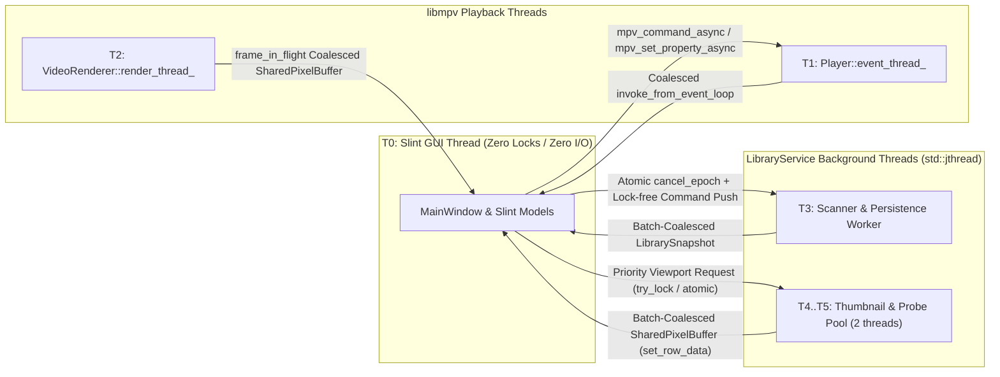

# Video Picker — UI, UX & Technical Implementation Specification

> **Document Status:** `ACTIVE (Implemented)` (Design, Performance & Concurrency Specification)  
> **Related Spec:** [Main Media Controls UI Spec](file:///var/home/anon/projects/mpvx/docs/main-media-controls-ui-spec.md)  
> **Target Toolchain & Dependencies:** C++26 (`CMAKE_CXX_STANDARD 26` in [CMakeLists.txt](file:///var/home/anon/projects/mpvx/CMakeLists.txt#L9-L11)), Slint `1.19.0` ([cmake/Dependencies.cmake](file:///var/home/anon/projects/mpvx/cmake/Dependencies.cmake#L44)), `libmpv` Client API v2.5 (`MPV_MAKE_VERSION(2, 5)` in [client.h](file:///var/home/anon/projects/mpvx/.deps/libmpv/include/mpv/client.h#L251))

This specification defines the **Video Picker** (Library) view for **mpvx**, detailing its spatial layout, hybrid navigation model, watch-position persistence, high-performance two-tier caching strategy, low-overhead zero-allocation parsing, and a **Zero UI Locks & Zero Deadlocks** concurrency architecture across **C++26 ↔ Slint 1.19 ↔ libmpv**.

---

## 1. Goals & Core Experience

1. **Immediate Boot-to-Library (< 8ms Time-to-First-Frame):**
   - When `mpvx` launches without a file or URL CLI argument ([src/main.cpp](file:///var/home/anon/projects/mpvx/src/main.cpp#L874-L883)), it opens directly into the **Video Picker** (`AppViewMode.Picker`) rooted at the user's XDG default videos directory (`$XDG_VIDEOS_DIR`, falling back to `$HOME/Videos`).
   - All filesystem traversal, watch-history hydration, and thumbnail decoding run asynchronously off the GUI thread so `main_window->run()` ([src/main.cpp](file:///var/home/anon/projects/mpvx/src/main.cpp#L886)) enters the Slint event loop immediately without blocking on disk I/O.
2. **Resume Where You Left Off:**
   - Videos display cached 16:9 thumbnails with a YouTube-style bottom progress bar reflecting the last saved watch position, plus a pinned **Continue Watching** shelf at the top of the **Home** view.
3. **Hybrid Navigation (Raised Sidebar + Streaming Shelves):**
   - A **raised, rounded left sidebar** provides fast file-tree navigation capped at **2 folder levels** by default.
   - Videos inside subfolders are surfaced in the main pane as **Apple TV+ / Netflix-style horizontal subcategory shelves** (`Folder Name` + `See all ›`), while deeper nesting (`> 2` levels) is navigated via main-pane drill-down and a breadcrumb bar.
4. **Fluid Motion (`60fps` Target):**
   - Crisp `120ms–220ms` hover micro-interactions on cards/sidebar items and a seamless zoom-crossfade transition between the **Picker** and the **Player** ([ui/components/video-view.slint](file:///var/home/anon/projects/mpvx/ui/components/video-view.slint)).
5. **Zero UI Locks & Zero Deadlocks Guarantee:**
   - The Slint GUI thread never performs blocking disk I/O (`open`, `statx`, `getdents64`, `fsync`), synchronous `libmpv` calls (`mpv_command`, `mpv_get_property`), image decoding (`slint::Image::load_from_path`), or blocking mutex acquisition (`std::mutex::lock`).

---

## 2. Visual Language & Theme Extensions (`ui/theme.slint`)

The Video Picker extends the existing dark-glass, monochrome-first palette and `#818cf8` indigo accent established in [ui/theme.slint](file:///var/home/anon/projects/mpvx/ui/theme.slint#L40-L80).

### 2.1 Existing & Proposed Theme Tokens

| Token | Type | Value | Status / Reference | Usage |
| :--- | :--- | :--- | :--- | :--- |
| `canvas-bg` | `color` | `#000000` | Existing ([ui/theme.slint](file:///var/home/anon/projects/mpvx/ui/theme.slint#L42)) | Base window & player background |
| `popover-bg` | `color` | `#12141ae6` | Existing ([ui/theme.slint](file:///var/home/anon/projects/mpvx/ui/theme.slint#L47)) | Glassmorphic popover surface |
| `popover-item-active` | `color` | `#818cf826` | Existing ([ui/theme.slint](file:///var/home/anon/projects/mpvx/ui/theme.slint#L50)) | Active sidebar item background |
| `icon-accent` | `color` | `#818cf8` | Existing ([ui/theme.slint](file:///var/home/anon/projects/mpvx/ui/theme.slint#L60)) | Active indicator pill & progress fill |
| `picker-bg` | `color` | `#090a0f` | Proposed ([ui/theme.slint](file:///var/home/anon/projects/mpvx/ui/theme.slint)) | Deep ambient background behind raised sidebar & shelves |
| `sidebar-bg` | `color` | `#12141ae6` | Proposed ([ui/theme.slint](file:///var/home/anon/projects/mpvx/ui/theme.slint)) | Raised left sidebar surface (matches `popover-bg`) |
| `sidebar-border` | `color` | `#ffffff1f` | Proposed ([ui/theme.slint](file:///var/home/anon/projects/mpvx/ui/theme.slint)) | 1px border ring on raised sidebar |
| `sidebar-radius` | `length` | `12px` | Proposed ([ui/theme.slint](file:///var/home/anon/projects/mpvx/ui/theme.slint)) | Corner radius for floating/inset sidebar |
| `sidebar-width` | `length` | `240px` | Proposed ([ui/theme.slint](file:///var/home/anon/projects/mpvx/ui/theme.slint)) | Expanded sidebar width |
| `card-bg` | `color` | `#0f1117` | Proposed ([ui/theme.slint](file:///var/home/anon/projects/mpvx/ui/theme.slint)) | Fallback background before thumbnail loads |
| `card-border` | `color` | `#ffffff14` | Proposed ([ui/theme.slint](file:///var/home/anon/projects/mpvx/ui/theme.slint)) | Resting 1px thumbnail border |
| `card-border-hover` | `color` | `#ffffff40` | Proposed ([ui/theme.slint](file:///var/home/anon/projects/mpvx/ui/theme.slint)) | Hover 1px thumbnail border |
| `card-radius` | `length` | `10px` | Proposed ([ui/theme.slint](file:///var/home/anon/projects/mpvx/ui/theme.slint)) | Thumbnail container corner radius |
| `progress-track` | `color` | `#ffffff38` | Proposed ([ui/theme.slint](file:///var/home/anon/projects/mpvx/ui/theme.slint)) | Unwatched portion of card progress bar (matches `seek-track`) |
| `progress-fill` | `color` | `#818cf8` | Proposed ([ui/theme.slint](file:///var/home/anon/projects/mpvx/ui/theme.slint)) | Watched progress fill on cards |
| `pill-bg` | `color` | `#000000b3` | Proposed ([ui/theme.slint](file:///var/home/anon/projects/mpvx/ui/theme.slint)) | Duration & watched badge background |

### 2.2 New Lucide SVG Icons (`ui/assets/icons/`)
Following the locked-in `24×24` `viewBox`, `2px` stroke width, `stroke="#000000"` convention in [docs/main-media-controls-ui-spec.md](file:///var/home/anon/projects/mpvx/docs/main-media-controls-ui-spec.md#L106-L154) and existing icons in [ui/assets/icons/](file:///var/home/anon/projects/mpvx/ui/assets/icons/):
- `layout-grid.svg` — Return to Library button in [ui/components/top-bar.slint](file:///var/home/anon/projects/mpvx/ui/components/top-bar.slint#L46-L95) & Home nav icon
- `panel-left.svg` — Toggle raised sidebar (`Ctrl+B`)
- `clock.svg` — Continue Watching & Recent nav items
- `folder.svg`, `chevron-right.svg` — Depth-2 folder tree nodes & `See all ›` shelf headers (reuses existing [chevron-down.svg](file:///var/home/anon/projects/mpvx/ui/assets/icons/chevron-down.svg) for expanded state)
- `film.svg` — Card placeholder icon before thumbnail generation completes
- `more-horizontal.svg` — Card hover context menu (`⋯`) button
- `search.svg` — Top-bar search filter field

---

## 3. Spatial Layout & Navigation Model

```
┌─────────────────────────────────────────────────────────────────────────┐
│  [☰]  mpvx  ·  Videos › Anime                    [Search /]  [Sort ▾]   │  ← Top Bar (56px)
├──────────────────┬──────────────────────────────────────────────────────┤
│ ┌──────────────┐ │  Continue Watching                                   │
│ │ Home         │ │  ┌──────────┐  ┌──────────┐  ┌──────────┐           │
│ │ Continue     │ │  │ ▓▓▓░░░░░ │  │ ▓▓▓▓▓▓░░ │  │ ▓░░░░░░░ │  ··· ›   │
│ │ Recent       │ │  └──────────┘  └──────────┘  └──────────┘           │
│ ├──────────────┤ │                                                      │
│ │ ▾ Movies     │ │  Videos in Root (if any)                             │
│ │   Action     │ │  ┌──────────┐  ┌──────────┐  ┌──────────┐           │
│ │   Sci-Fi     │ │  │          │  │          │  │          │           │
│ │ ▸ Anime      │ │  └──────────┘  └──────────┘  └──────────┘           │
│ │ ▸ Tutorials  │ │                                                      │
│ │              │ │  Movies                                  See all ›   │
│ │              │ │  ┌──────────┐  ┌──────────┐  ┌──────────┐           │
│ │ [Open…]      │ │  │          │  │          │  │          │  ··· ›   │
│ └──────────────┘ │  └──────────┘  └──────────┘  └──────────┘           │
└──────────────────┴──────────────────────────────────────────────────────┘
```

### 3.1 Raised, Rounded Left Sidebar
- **Geometry:** Inset inside `window-shell` ([ui/app-window.slint](file:///var/home/anon/projects/mpvx/ui/app-window.slint#L203-L210)) with `12px` outer margin (`top: Theme.top-bar-content-height`, `left: 12px`, `bottom: 12px`), `width: 240px`, `border-radius: 12px`, `background: Theme.sidebar-bg`, `border-width: 1px`, `border-color: Theme.sidebar-border`.
- **Collapsible:** Toggled via the top-bar sidebar button or `Ctrl+B`. When collapsed, `width` animates to `0px` (`200ms ease-out`) and the main content area expands smoothly to fill the width.
- **Pinned Views:**
  - **Home** (default on boot: `$XDG_VIDEOS_DIR` root + subcategory shelves)
  - **Continue Watching** (filtered grid of all in-progress videos across the library)
  - **Recent** (all library videos sorted by `mtime` descending)
- **Depth-2 Folder Tree:**
  - Displays immediate subdirectories of `$XDG_VIDEOS_DIR` (**Depth 1**) and their immediate subdirectories (**Depth 2**).
  - Folders deeper than Depth 2 are **not** indented into the sidebar tree to prevent horizontal crowding and visual clutter.
  - Active item uses `Theme.popover-item-active` (`#818cf826`, [ui/theme.slint](file:///var/home/anon/projects/mpvx/ui/theme.slint#L50)) with a `3px × 16px` `#818cf8` left indicator pill.
- **Footer Actions:** Pinned bottom row with **Open File…** and **Open Folder…** (allows temporarily browsing a folder outside `$XDG_VIDEOS_DIR`).

### 3.2 Main Content Area (Shelves + Grid + Breadcrumbs)
- **Breadcrumb Bar:** Shown when viewing any folder (`Videos › Movies › Sci-Fi`). Clicking any segment navigates directly to that level.
- **Continue Watching Shelf (Home only):** Shown at the top when at least one video has `0.05 <= progress < 0.95`. Sorted by `last_watched_at` descending.
- **Direct Videos Grid:** Any video files located directly in the currently selected folder render in a responsive multi-column grid (minimum card width `220px`, `16px` gap).
- **Subcategory Shelves (Apple TV+ / Netflix Style):**
  - Each immediate subfolder of the current folder renders as a horizontal shelf below the direct grid.
  - **Shelf Header:** `Folder Name` (`15px`, weight `600`, `Theme.text-primary`) + muted item count (`Theme.text-muted`) on the left; `See all ›` button on the right.
  - **Shelf Content:** Horizontal scrollable row of video cards (populated from that subfolder, recursively flattened up to a cap of `20` preview items). Left/right edge scroll chevrons appear on hover.
  - **Drill-Down (Depth > 2):** Clicking `See all ›` (or a subfolder in the sidebar) navigates the main pane into that folder, updating the breadcrumb bar and displaying *its* direct videos + *its* immediate subfolders as shelves.

---

## 4. Video Card & Watch Position UX

### 4.1 Card Anatomy
1. **16:9 Thumbnail Frame (`card-radius: 10px`):**
   - Displays the cached frame thumbnail (`image-fit: cover`).
   - If the thumbnail is still generating, shows a subtle dark `#0f1117` placeholder with a centered `film` Lucide icon (`Theme.icon-disabled`).
2. **YouTube-Style Watch Progress Bar:**
   - Anchored at the bottom edge of the clipped thumbnail container (`height: 3px`, `width: 100%`).
   - Only visible when `progress > 0.0`.
   - Track: `Theme.progress-track`; Fill: `Theme.progress-fill` (`width: parent.width * clamp(progress, 0.0, 1.0)`).
3. **Corner Badges:**
   - **Bottom-Right:** Duration pill (`0:43:02` or `12:18`, formatted via `mpvx::format_timestamp` in [include/mpvx/core.hpp](file:///var/home/anon/projects/mpvx/include/mpvx/core.hpp#L75-L88), `11px` tabular-nums, `#000000b3`, `4px` radius, `4px 6px` padding).
   - **Top-Right (if `progress >= 0.95`):** Subtle `Watched` checkmark pill (reusing [ui/assets/icons/check.svg](file:///var/home/anon/projects/mpvx/ui/assets/icons/check.svg)).
4. **Metadata Block (below thumbnail, `8px` top spacing):**
   - **Title:** Cleaned filename (extension stripped, `_` / `.` normalized optionally or preserved cleanly), `13px`, weight `500`, `Theme.text-primary`, max 2 lines with ellipsis.
   - **Subtitle:** `12px`, `Theme.text-muted` — shows `"14:20 left"` when in progress, or `"MKV · 1.4 GB"` when unwatched.

### 4.2 Resume & Context Actions
- **Default Click:** Opens the video in the Player and automatically seeks to `last_position_sec` (if `0.05 <= progress < 0.95`) once `MPV_EVENT_FILE_LOADED` fires ([src/player.cpp](file:///var/home/anon/projects/mpvx/src/player.cpp#L945-L964)).
- **Secondary / Context Actions (Right-Click Menu or Hover `⋯` Button):**
  - *Play from beginning* (`resume = false`)
  - *Mark as watched* (sets `progress = 1.0`, `watched = true`)
  - *Reset watch progress* (sets `progress = 0.0`, `watched = false`)
  - *Reveal in file manager* (asynchronously launches `xdg-open` on parent directory via `posix_spawnp` and reaps finished child PIDs non-blockingly with `waitpid(..., WNOHANG)`)

---

## 5. Hover Animations & Click Transitions

All animations target `60fps` in Slint using declarative `animate` blocks on `opacity`, `width`, `height`, `background`, and `border-color` properties, matching the pattern in [ui/components/icon-button.slint](file:///var/home/anon/projects/mpvx/ui/components/icon-button.slint#L39-L51) and [ui/components/popovers.slint](file:///var/home/anon/projects/mpvx/ui/components/popovers.slint#L121-L122).

### 5.1 Hover Micro-Interactions
- **Video Card Hover (`160ms ease-out`):**
  - Thumbnail image scales subtly (`1.0 → 1.035` via `width`/`height`/`x`/`y` interpolation inside its clipped `10px` frame).
  - Card border transitions from `Theme.card-border` (`#ffffff14`) to `Theme.card-border-hover` (`#ffffff40`).
  - A soft dark vignette (`#00000040`) and a centered `44px × 44px` circular Play button (`#00000099`, `1px` `#ffffff40` border, [play.svg](file:///var/home/anon/projects/mpvx/ui/assets/icons/play.svg) icon) fade in (`opacity: 0 → 1`).
  - Progress bar thickens slightly (`3px → 4px`) for readability (paralleling the `3px → 5px` seek-bar hover expansion in [ui/components/seek-bar.slint](file:///var/home/anon/projects/mpvx/docs/main-media-controls-ui-spec.md#L294)).
- **Sidebar & Shelf Header Hover (`120ms ease-out`):**
  - Sidebar rows fade background `#ffffff00 → #ffffff14` (`Theme.popover-item-hover`).
  - `See all ›` nudges its chevron `2px` to the right on hover.

### 5.2 Click Transitions (Picker ↔ Player)
- **Picker → Player (`220ms ease-out`):**
  1. `MainWindow` switches `view-mode` from `AppViewMode.Picker` to `AppViewMode.Player`.
  2. Picker layer fades out (`opacity: 1.0 → 0.0`) while the `#000000` `VideoView` layer ([ui/components/video-view.slint](file:///var/home/anon/projects/mpvx/ui/components/video-view.slint#L3-L24)) is revealed underneath. Once `picker-opacity < 0.01`, the Picker subtree is gated via `visible: root.view-mode == AppViewMode.Picker || root.picker-opacity > 0.01` ([ui/app-window.slint](file:///var/home/anon/projects/mpvx/ui/app-window.slint#L244-L245)) so Slint skips layout and hit-testing of library cards during video playback while preserving scroll position and loaded card state.
  3. Simultaneously, the C++ backend calls `Player::load_file(path)` ([src/player.cpp](file:///var/home/anon/projects/mpvx/src/player.cpp#L226-L246)) and records a pending atomic resume target `pending_resume_sec_`. When `MPV_EVENT_FILE_LOADED` fires ([src/player.cpp](file:///var/home/anon/projects/mpvx/src/player.cpp#L945-L964)), `Player` dispatches `Player::seek(target, true)` ([src/player.cpp](file:///var/home/anon/projects/mpvx/src/player.cpp#L285-L301)).
  4. The player HUD (`TopBar` + `ControlsBar`) starts visible (`reset-hud-timer()` in [ui/app-window.slint](file:///var/home/anon/projects/mpvx/ui/app-window.slint#L155-L158)) for `2.5s` so the user sees the title and resumed timestamp, then auto-hides normally.
- **Player → Picker (`200ms ease-out`):**
  1. Triggered by clicking the **Library** (`layout-grid`) button in `TopBar` ([ui/components/top-bar.slint](file:///var/home/anon/projects/mpvx/ui/components/top-bar.slint)) or pressing `Esc` when not fullscreen and no popover is open ([ui/app-window.slint](file:///var/home/anon/projects/mpvx/ui/app-window.slint#L461-L472)).
  2. Playback **continues** in the mini player: the video morphs into a floating tile in the bottom-right corner while the Picker is revealed beneath it at the user's exact previous scroll position and folder. The current `player->time_pos()` and `player->duration()` are still flushed to the asynchronous watch-history writer. With no video (nothing loaded, audio-only or idle) the Picker simply fades back in. See the [Mini Player UI Spec](mini-player-ui-spec.md), which supersedes the former "playback pauses" behaviour.

### 5.3 Keyboard Shortcuts (Picker Mode vs Player Mode)
In [ui/app-window.slint](file:///var/home/anon/projects/mpvx/ui/app-window.slint#L390-L475), `key-scope` branches on `root.view-mode`:

| Shortcut | Mode | Action |
| :--- | :--- | :--- |
| `Ctrl+B` | `Picker` | Toggle raised left sidebar (`root.sidebar-open = !root.sidebar-open`) |
| `/` or `Ctrl+F` | `Picker` | Focus search/filter input in top bar |
| `Esc` | `Picker` | Clear search filter if non-empty, else return to `Player` if `root.has-video` is true |
| `Esc` | `Player` | Close active popover → exit fullscreen → transition `view-mode` to `AppViewMode.Picker` |
| `Backspace` | `Picker` | Navigate up one folder level in breadcrumb trail |

---

## 6. Slint UI Component Architecture & Contracts

### 6.1 New Data Types (`ui/theme.slint`)
```slint
export enum AppViewMode {
    Picker,
    Player,
}

export enum PickerNavKind {
    Home,
    ContinueWatching,
    Recent,
    Folder,
}

export enum PickerSortMode {
    Name,
    Recent,
    Progress,
}

export struct VideoEntry {
    id: string,              // 64-bit hex cache key or canonical path
    path: string,
    title: string,
    subtitle: string,        // e.g. "14:20 left" or "MKV · 1.4 GB"
    duration-text: string,   // e.g. "43:02"
    duration-sec: float,
    position-sec: float,
    progress: float,         // 0.0 .. 1.0
    watched: bool,
    thumbnail: image,
    has-thumbnail: bool,
}

export struct FolderNode {
    path: string,
    name: string,
    depth: int,              // 1 or 2 in sidebar
    has-children: bool,
    expanded: bool,
    selected: bool,
}

export struct ShelfSection {
    folder-path: string,
    title: string,
    total-count: int,
    items: [VideoEntry],     // Backed by a persistent inner slint::VectorModel<VideoEntry>
}

export struct VideoGridRow {
    row-index: int,
    items: [VideoEntry],     // Fixed-capacity row slice (e.g. 4..6 cards) for 1D ListView virtualization
}
```

### 6.2 Proposed Slint Files
- `ui/components/picker/video-card.slint` — Reusable 16:9 card with hover scale, play-pill overlay, progress bar, duration badge, accessibility metadata (`accessible-role: button`, `accessible-label: root.entry.title`), `init => { root.request-thumbnail(root.entry.id, root.entry.path); }` viewport visibility hook, and `clicked` / `play-from-start` / `mark-watched-toggled` callbacks.
- `ui/components/picker/shelf-row.slint` — Horizontal `Flickable` shelf with `title`, `total-count`, `See all ›` callback, and edge scroll buttons.
- `ui/components/picker/sidebar.slint` — `PickerSidebar`: raised, rounded floating panel (`Theme.sidebar-bg`, `12px` radius) with pinned views, depth-2 folder tree (`ListView`), and footer actions.
- `ui/components/picker/video-picker.slint` — Composes `PickerSidebar` + main view (`BreadcrumbBar`, virtualized row-chunked `ListView` for `1,000+` direct videos in `ContinueWatching` / `Recent` / `Folder` views, or `ContinueWatching` shelf + direct `VideoCard` rows + `ShelfRow` list in `Home` mode) + empty/loading states.

### 6.3 `MainWindow` Additions (`ui/app-window.slint`)
```slint
// View Mode
in-out property <AppViewMode> view-mode: AppViewMode.Picker;
in-out property <bool> sidebar-open: true;
in-out property <PickerNavKind> active-nav-kind: PickerNavKind.Home;
in-out property <PickerSortMode> picker-sort-mode: PickerSortMode.Name;
in-out property <string> current-folder-path: "";

// Picker Models (backed by slint::Model<T> on the GUI thread)
in property <[FolderNode]> picker-folders: [];
in property <[string]> picker-breadcrumbs: [];
in property <[VideoEntry]> picker-continue-watching: [];
in property <[VideoEntry]> picker-direct-videos: [];
in property <[VideoGridRow]> picker-direct-video-rows: []; // Virtualized ListView rows for 1,000+ video folders
in property <int> picker-grid-columns: 4;
in property <[ShelfSection]> picker-shelves: [];
in-out property <string> picker-search-query: "";
in property <bool> picker-scanning: false;

// Picker Callbacks
callback picker-nav-selected(PickerNavKind, string /* path */);
callback picker-folder-toggled(string /* path */);
callback picker-breadcrumb-clicked(int /* index */);
callback picker-navigate-up();
callback picker-video-clicked(string /* path */, bool /* resume */);
callback picker-mark-watched(string /* path */, bool /* watched */);
callback picker-reveal-in-file-manager(string /* path */);
callback picker-request-thumbnail(string /* cache_key_hex */, string /* path */);
callback picker-grid-columns-changed(int /* columns */);
callback picker-search-changed(string);
callback picker-sort-changed(PickerSortMode);
callback picker-open-external-folder();
callback return-to-picker-clicked();
callback return-to-player-clicked();
```

### 6.4 Row-Chunked 2D Grid Virtualization & Persistent Nested Models (`notify_row_changed`)
> [!IMPORTANT]
> 1. **1D `ListView` Row-Chunked Grid Virtualization (Avoiding 1,000+ Element Instantiation Spikes):**
>    Slint's standard `Flickable` + `for entry in model` instantiates **all** child elements upfront on the GUI thread, whereas `ListView` virtualizes items along the vertical axis. To sustain `60fps` in folders or `Recent` views with `1,000+` videos, `picker-direct-video-rows` chunks `VideoEntry` items into `VideoGridRow` slices of `N = picker-grid-columns` cards (`clamp(floor(available_width / 236px), 2, 8)`), each backed by an inner `std::shared_ptr<slint::VectorModel<VideoEntry>>`. Slint's `ListView` only instantiates the `~4–6` visible `VideoGridRow` rows (`~16–36` `VideoCard` elements) at any time.
> 2. **Persistent Nested `VectorModel`s & $O(1)$ Cell Lookup Table (`notify_row_changed`):**
>    Per Slint's C++ model architecture (`<slint/private/slint_models.h>`), `slint::Model<ModelData>` is **single-threaded (GUI thread only)** and tracks row-level dirty state via `notify_row_changed(size_t row)`.
>    - Every `ShelfSection.items` and `VideoGridRow.items` field holds a persistent `std::shared_ptr<slint::VectorModel<VideoEntry>>` (converted via `slint::ModelRc<VideoEntry>`).
>    - On the GUI thread, `PickerUiController` ([src/main.cpp](file:///var/home/anon/projects/mpvx/src/main.cpp#L87-L130)) maintains a reverse lookup table:
>      ```cpp
>      struct ModelCellRef {
>          std::shared_ptr<slint::VectorModel<VideoEntry>> model;
>          size_t row_index;
>      };
>      std::unordered_map<uint64_t, std::vector<ModelCellRef>> key_to_cells_;
>      ```
>    - When a background worker finishes generating a thumbnail or probing duration for `cache_key`, the GUI thread **NEVER** calls `set_row_data` on the outer `picker_shelves` or `picker_direct_video_rows` model (which would reassign `items` and reset all cards in that shelf/row). Instead, it looks up `key_to_cells_[cache_key]` and calls `cell.model->set_row_data(cell.row_index, updated_entry)` directly on each inner `VectorModel<VideoEntry>`, repainting only that single `VideoCard` in $O(1)$ time (including when the same video appears simultaneously in *Continue Watching* and a folder shelf).

---

## 7. High-Performance Two-Tier Caching Strategy

To achieve instant startup and `60fps` scrolling across libraries with `1,000+` video files without external database dependencies, `LibraryService` implements a **Two-Tier Cache (L1 In-Memory + L2 Compact Binary Disk Cache)** alongside a **Content-Addressed Raw RGBA8/QOI Thumbnail Cache**.

### 7.1 Deterministic 64-Bit Cache Key (`FNV-1a` / `SplitMix64`)
Every video file is uniquely identified by a 64-bit fingerprint computed from its canonical path, modification timestamp (`mtime_ns`), and byte size (`file_size`) obtained from a single `statx` / `std::filesystem::directory_entry` metadata read—**never** by hashing multi-gigabyte video contents:

```cpp
[[nodiscard]] constexpr uint64_t compute_media_cache_key(
    std::string_view canonical_path,
    int64_t mtime_ns,
    uint64_t file_size) noexcept
{
    uint64_t h = 14695981039346656037ULL; // FNV-1a 64-bit offset basis
    for (unsigned char c : canonical_path) {
        h ^= static_cast<uint64_t>(c);
        h *= 1099511628211ULL;            // FNV-1a prime
    }
    h ^= static_cast<uint64_t>(mtime_ns) + 0x9e3779b97f4a7c15ULL + (h << 6) + (h >> 2);
    h ^= file_size + 0x9e3779b97f4a7c15ULL + (h << 6) + (h >> 2);
    return h;
}
```
- If a file is re-encoded, replaced, or truncated, its `(mtime_ns, file_size)` tuple changes, automatically invalidating stale duration metadata and thumbnails without manual cache purging.

### 7.2 L1 In-Memory Cache (Arena String Pool + Generational Snapshots + Decoded Pixel LRU)
1. **Contiguous String Arena (`StringArena` + `StringSlice`):**
   - A library of `5,000` videos has `~20,000` strings (paths, filenames, titles, subtitles, duration labels). Allocating individual `std::string` heap objects during scanning fragments the allocator and degrades CPU cache locality.
   - `LibraryViewSnapshot` packs all scanned strings into a single contiguous `StringArena` (`std::vector<char> buffer`) and references them inside `ArenaVideoItem` / `ArenaFolderNode` via 8-byte `StringSlice { uint32_t offset; uint32_t length; }` handles (with convenience `std::string_view view(StringSlice) const noexcept` accessors). `slint::SharedString` instances are only materialized on the GUI thread for bound model rows.
2. **Immutable Generational Snapshots:**
   - The background scanner builds a `std::shared_ptr<const LibraryViewSnapshot>` containing flat sorted vectors of folders and media entries backed by its `StringArena`.
   - Once constructed, the snapshot is immutable and shared across threads without lock contention.
3. **Bounded Decoded Thumbnail LRU (`L1 Pixel Cache`):**
   - Stores `slint::SharedPixelBuffer<slint::Rgba8Pixel>` (`<slint/private/slint_image.h>`) keyed by `uint64_t cache_key`.
   - **Capacity Cap:** Bounded to `128` thumbnails at `320×180×4` bytes (`230.4 KB` per frame $\approx 29.5\text{ MB}$ maximum RAM).
   - **Copy-Free Sharing:** Per `<slint/private/slint_image.h>`, `SharedPixelBuffer` wraps a reference-counted `slint::SharedVector<Rgba8Pixel>` (`m_data`). Copying a `SharedPixelBuffer` from the L1 cache into a `slint::Image` on the GUI thread is an $O(1)$ atomic reference count increment with **zero pixel buffer copies**.

### 7.3 L2 On-Disk Metadata Index (`$XDG_CACHE_HOME/mpvx/media-index.bin`)
- **Purpose:** Persists probed video durations (`duration_sec`), video dimensions (`width`, `height`), and container types across application restarts so subsequent launches populate card durations in `< 0.5ms` via a single sequential bulk read without re-probing files.
- **In-Memory $O(1)$ Lookup & Batched Atomic Compaction:**
  - On `LibraryService` startup (on `T3`), `media-index.bin` is read in a single sequential `read(2)` into a `std::vector<MediaIndexRecord>` and bulk-inserted into an in-memory hash table `std::unordered_map<uint64_t, MediaIndexRecord> media_index_` (`media_index_.reserve(header.entry_count)`).
  - During directory scans, duration and thumbnail-existence lookups hit `media_index_` in $O(1)$ time with zero disk seeks.
  - When background workers (`T4..T5`) probe new files, new `MediaIndexRecord` entries are merged into `media_index_` and marked dirty (`index_dirty_ = true`). `T3` flushes `media_index_` atomically (`media-index.bin.tmp` $\rightarrow$ `rename(2)`) **once** when the thumbnail work queue drains (or every `15s` / on shutdown)—never rewriting the index file on every individual probe.
- **Fixed-Size Binary Record Format (Little-Endian, 32 Bytes per Entry):**
  ```cpp
  struct alignas(8) MediaIndexHeader {
      uint32_t magic{0x5856504D}; // "MPVX"
      uint32_t version{1};
      uint64_t entry_count{0};
      uint64_t payload_crc64{0};
  };

  struct alignas(8) MediaIndexRecord {
      uint64_t cache_key;      // compute_media_cache_key(path, mtime_ns, size)
      double   duration_sec;   // Probed media duration
      uint32_t width;          // Video width in px
      uint32_t height;         // Video height in px
      uint32_t flags;          // Bit 0: has_thumbnail_on_disk
      uint32_t reserved{0};
  };
  static_assert(sizeof(MediaIndexRecord) == 32);
  ```

### 7.4 L2 On-Disk Thumbnail Cache (`$XDG_CACHE_HOME/mpvx/thumbnails/<key_hex>.mpxt`)
- **Why Not Decode JPEG on the GUI Thread?**
  Calling `slint::Image::load_from_path()` (`<slint/private/slint_image.h>`) on the Slint GUI thread performs synchronous file I/O and JPEG decompression during frame painting, causing `5ms–25ms` frame spikes when scrolling through shelves.
- **Uncompressed / Fast-Header `.mpxt` Thumbnail Format:**
  - Thumbnails are cached on disk at `$XDG_CACHE_HOME/mpvx/thumbnails/<16-hex-char-key>.mpxt` at a fixed `320×180` (16:9) resolution (`230,400` bytes of raw `Rgba8Pixel` data preceded by a 16-byte header: `magic = 0x5458504D`, `width = 320`, `height = 180`, `format = 4`).
  - **Worker-Thread Hydration:** A background worker reads the `230 KB` file directly into a `slint::SharedPixelBuffer<slint::Rgba8Pixel>(320, 180)` (`buffer.begin()`) in `< 0.15ms` with **zero image decompression CPU overhead**, then sends the `SharedPixelBuffer` to the GUI thread where `slint::Image(buffer)` (`<slint/private/slint_image.h>`) wraps it in $O(1)$ time.
  - **Atomic Write-Rename:** Thumbnail workers always write to `<key>.mpxt.tmp.<tid>` and call `std::filesystem::rename` (`rename(2)`) so readers never observe a half-written thumbnail file.

### 7.5 Thumbnail Generation Backend (3-Tier Zero-Waste Pipeline, Isolated From Active Playback)
- **Constraint From `libmpv` Documentation ([render.h](file:///var/home/anon/projects/mpvx/.deps/libmpv/include/mpv/render.h#L117-L153)):**
  1. [render.h:117](file:///var/home/anon/projects/mpvx/.deps/libmpv/include/mpv/render.h#L117): *"Currently, there can be only 1 `mpv_render_context` at a time per mpv core."*
  2. [render.h:63-64](file:///var/home/anon/projects/mpvx/.deps/libmpv/include/mpv/render.h#L63-L64): `mpv_render_*` calls on a separate `mpv_handle` core are completely independent of the main playback core.
- **Architecture:**
  - The thumbnail worker pool (`clamp(hardware_concurrency / 2, 2, 4)` `std::jthread` workers) **NEVER** touches `Player::handle()` ([include/mpvx/player.hpp](file:///var/home/anon/projects/mpvx/include/mpvx/player.hpp#L88)) or `VideoRenderer` ([include/mpvx/renderer.hpp](file:///var/home/anon/projects/mpvx/include/mpvx/renderer.hpp)).
  - **Tier 1A — Zero-Decoder Direct Container Cover Extraction (`< 0.5ms` probe + `~5–25ms` decode):**
    - Before initializing any video decoder, `probe_container_for_thumbnail()` reads container headers directly in-process:
      - **Matroska / WebM (EBML):** Parses `SeekHead`, `Info` (`TimecodeScale`, `Duration`), `Tracks` (`PixelWidth`, `PixelHeight`), and `Attachments` (`AttachedFile` image payloads such as `cover.webp` / `cover.png` / `cover.jpg`, skipping font attachments).
      - **ISOBMFF (`.mp4`, `.m4v`, `.mov`):** Walks top-level boxes (skipping `mdat` in $O(1)$ via `seekg`) and reads `moov` (`mvhd` duration, `trak/tkhd` video dimensions, and `udta/meta/ilst/covr/data` cover art).
    - When embedded cover bytes are found, `decode_and_resize_cover_image()` decodes them in-process via `slint::Image::load_from_data().to_rgba8()` and performs a centered aspect-fill (`cover`) box-filter downsample to `320×180` (`resize_cover_rgba8()`) with zero `libmpv` or subprocess overhead.
  - **Tier 1B — Adjacent Sidecar Cover Image:**
    - If no embedded container cover exists, checks for `<stem>.{webp,jpg,jpeg,png}` next to the video file and decodes it in-process.
  - **Tier 2 — Single-Pass `libmpv` 10% Frame Fallback:**
    - Only when neither an embedded container cover nor a sidecar image exists, each worker uses a persistent thread-local `mpv_handle*` + `mpv_render_context*` (`MPV_RENDER_API_TYPE_SW` at `320×180`) configured with:
      `vo=libmpv`, `ao=null`, `vid=auto`, `aid=no`, `sid=no`, `hwdec=no`, `load-scripts=no`, `osc=no`, `osd-level=0`, `sub-auto=no`, `audio-file-auto=no`, `autoload-files=no`, `vd-lavc-threads=2`, `hr-seek=no`, `vd-lavc-fast=yes`, `vd-lavc-skiploopfilter=all`, `demuxer-readahead-secs=0`, `cache=no`, `pause=yes`, `keep-open=yes`, `image-display-duration=inf`, `video-timing-offset=0`, `msg-level=all=no`.
    - Because Tier 1A already parsed MKV/WebM/MP4/MOV headers (`probe.parsed == true`) and extracted duration/dimensions, `ThreadLocalThumbExtractor` skips loading frame `t=0` and jumps straight to a **single-pass** `loadfile` with `vid=1,start=10%`. For exotic containers (`.avi`, `.flv`, `.ts`, `.wmv`), it loads `vid=auto`, checks `track-list` for any embedded `albumart`/`image` track, and otherwise seeks `10%` in-place.
  - **Optional Last-Resort Fallback (`ffmpeg` Pipe via `posix_spawnp`):** If the isolated software render context fails on an exotic container, seeks `10%` (`-ss <10%_sec>` / `-ss 1` / frame 0) with cancellation and deadline enforcement.

---

## 8. Low-Overhead Zero-Allocation Parsing Strategy

To keep startup, directory scanning, and watch-history loading deterministic and free of third-party parser bloat (notice [cmake/Dependencies.cmake](file:///var/home/anon/projects/mpvx/cmake/Dependencies.cmake) includes only `libmpv`, `Slint`, and `Catch2`), all parsers are written as pure, zero-exception C++26 state machines operating over `std::string_view` and `std::span<const char>`.

### 8.1 Zero-Regex XDG `user-dirs.dirs` Parser (`std::string_view`)
Resolves `$XDG_VIDEOS_DIR` in `< 20µs` without spawning `xdg-user-dir` subprocesses or compiling `<regex>`:
1. Check `std::getenv("XDG_VIDEOS_DIR")`; if non-empty and absolute, return it.
2. Read `$XDG_CONFIG_HOME/user-dirs.dirs` (fallback `$HOME/.config/user-dirs.dirs`) into a stack/small buffer.
3. Scan line-by-line with `std::string_view::find('\n')`:
   - Trim leading ASCII whitespace; skip lines starting with `'#'`.
   - Match prefix `XDG_VIDEOS_DIR="`, strip trailing `"` and expand leading `$HOME/` or `${HOME}/` to the resolved home directory.
4. Verify existence with `std::filesystem::is_directory(path, ec)`; fall back to `$HOME/Videos`.

### 8.2 Branchless Case-Insensitive Extension Classifier
Instead of allocating a lowercase `std::string` copy of every filename extension on disk (`path.extension().string()`), classify extensions in $O(1)$ using a packed 64-bit ASCII lower-casing mask:

```cpp
[[nodiscard]] constexpr uint64_t pack_ext_lower(std::string_view ext) noexcept {
    if (ext.empty() || ext.size() > 8) return 0;
    uint64_t packed = 0;
    for (size_t i = 0; i < ext.size(); ++i) {
        unsigned char c = static_cast<unsigned char>(ext[i]);
        if (c >= 'A' && c <= 'Z') c |= 0x20; // ASCII tolower
        packed |= (static_cast<uint64_t>(c) << (i * 8));
    }
    return packed;
}

[[nodiscard]] constexpr bool is_supported_video_extension(std::string_view filename) noexcept {
    auto dot = filename.rfind('.');
    if (dot == std::string_view::npos || dot == 0) return false; // Skip hidden dot-files & extensionless files
    switch (pack_ext_lower(filename.substr(dot))) {
        case pack_ext_lower(".mp4"):
        case pack_ext_lower(".mkv"):
        case pack_ext_lower(".webm"):
        case pack_ext_lower(".mov"):
        case pack_ext_lower(".avi"):
        case pack_ext_lower(".m4v"):
        case pack_ext_lower(".ts"):
        case pack_ext_lower(".flv"):
        case pack_ext_lower(".wmv"):
            return true;
        default:
            return false;
    }
}
```

### 8.3 Zero-Allocation Filename Title Normalizer (`normalize_video_title_to`)
Transforms raw filenames like `"Blade.Runner.2049.2017.2160p.UHD.BluRay.x265.mkv"` or `"01_Introduction_to_C++26.mp4"` into clean display titles in a single pass:
- Strip extension suffix (`filename.substr(0, dot)`).
- Replace `_` and `.` (when flanked by non-digit characters) with spaces while collapsing consecutive spaces into one.
- `normalize_video_title_to(std::string_view filename, StringArena& arena) -> StringSlice` appends directly into `LibraryViewSnapshot::arena` with zero intermediate heap allocations (`normalize_video_title(filename)` wraps it for standalone callers/tests).

### 8.4 Zero-Allocation Watch-History Persistence (`watch-history.tsv`)
- **TSV Store (`$XDG_STATE_HOME/mpvx/watch-history.tsv`):**
  - Rather than JSON (which requires dynamic allocations for escaping arbitrary POSIX paths), `WatchHistoryStore` uses a line-oriented tab-separated values format (`watch-history.tsv`, [src/library.cpp](file:///var/home/anon/projects/mpvx/src/library.cpp#L969)) parsed in a single pass over `std::string_view` using `std::from_chars` from `<charconv>` for `double position_sec`, `double duration_sec`, and `int64_t last_watched_at`.
  - `std::from_chars` is locale-independent (unaffected by `LC_NUMERIC`, which is critical alongside `libmpv` per [client.h:147-149](file:///var/home/anon/projects/mpvx/.deps/libmpv/include/mpv/client.h#L147-L149)), never allocates memory, and never throws exceptions.
  - **Atomic Persistence:** Flushing writes to `watch-history.tsv.tmp` in the same directory, flushes the stream, and atomically replaces the target via `std::filesystem::rename(tmp_path, target_path, ec)`.

---

## 9. Zero UI Locks & Zero Deadlocks Strategy (Formal Concurrency Architecture)

This section establishes the strict concurrency invariants that prevent UI freezes, frame drops, priority inversion, and thread deadlocks in **mpvx**.

### 9.1 Evidence From Codebase & Upstream Documentation
1. **Slint Event Loop & Model Thread Affinity:**
   - `<slint/slint.h>`: `slint::run_event_loop()` asserts `private_api::assert_main_thread()`.
   - `<slint/private/slint_models.h>`: *"Note that the Model is not thread-safe. All Model operations need to be done in the main thread. If you need to update the model data from another thread, use the `slint::invoke_from_event_loop()` function."* Every `notify_row_changed` / `notify_reset` call executes `private_api::assert_main_thread()`.
   - `<slint/slint.h>`: `slint::blocking_invoke_from_event_loop()` warns: *"This function must be called from a different thread than the thread that runs the event loop otherwise it will result in a deadlock. Calling this function if the event loop is not running will also block forever."* **Rule:** `blocking_invoke_from_event_loop` is **BANNED** across the entire `mpvx` codebase.
2. **`libmpv` Core Lock & Render Thread Deadlock Rules:**
   - [client.h:136-139](file:///var/home/anon/projects/mpvx/.deps/libmpv/include/mpv/client.h#L136-L139): *"Everything is serialized through a single lock in the playback core."*
   - [client.h:102-106](file:///var/home/anon/projects/mpvx/.deps/libmpv/include/mpv/client.h#L102-L106): *"Synchronous calls have to wait until the playback core is ready, which currently can take an unbounded time (e.g. if network is slow or unresponsive). Asynchronous calls just queue operations as requests."*
   - [render.h:65-83](file:///var/home/anon/projects/mpvx/.deps/libmpv/include/mpv/render.h#L65-L83): *"never can be called from within the callbacks set with `mpv_set_wakeup_callback()` or `mpv_render_context_set_update_callback()`... there must be no lock or wait dependency from the render thread to a thread using other libmpv functions."*
3. **Existing `mpvx` Lock-Free & Coalescing Patterns:**
   - [src/main.cpp](file:///var/home/anon/projects/mpvx/src/main.cpp): Uses `frame_in_flight->exchange(true, std::memory_order_acq_rel)` to coalesce video frames so `slint::invoke_from_event_loop` never floods the GUI event queue.
   - [src/player.cpp:697-707](file:///var/home/anon/projects/mpvx/src/player.cpp#L697-L707): Copies `std::function` callbacks out of `Player::mutex_` under a short `std::lock_guard`, releases `mutex_`, and invokes the callback unlocked.

### 9.2 Thread Inventory & Strict Responsibility Matrix



| Thread | Owner Class | Allowed Operations | Forbidden Operations |
| :--- | :--- | :--- | :--- |
| **T0: GUI Thread** | `main()` / Slint Event Loop ([src/main.cpp](file:///var/home/anon/projects/mpvx/src/main.cpp#L886)) | Slint rendering, `VectorModel::set_row_data`, reading `std::atomic` state, posting async commands (`mpv_command_async`), waking workers via lock-free ring or `try_lock` | **NO** disk I/O (`std::filesystem`, `open`, `popen`), **NO** `std::mutex::lock()` across I/O, **NO** synchronous `mpv_command` / `mpv_get_property`, **NO** `thread.join()` during runtime |
| **T1: MPV Event Thread** | `Player::event_thread_` ([include/mpvx/player.hpp](file:///var/home/anon/projects/mpvx/include/mpvx/player.hpp#L100)) | `mpv_wait_event`, updating `Player` atomics, firing `PlayerCallbacks` unlocked | **NO** direct Slint UI calls, **NO** calling `LibraryService` under `Player::mutex_` |
| **T2: Render Thread** | `VideoRenderer::render_thread_` ([include/mpvx/renderer.hpp](file:///var/home/anon/projects/mpvx/include/mpvx/renderer.hpp#L57)) | `mpv_render_context_update`, `mpv_render_context_render` into `SharedPixelBuffer` | **NO** `client.h` calls on `player->handle()`, **NO** blocking on T0/T1/T3/T4 |
| **T3: Library Scanner & I/O Worker** | `LibraryService::scanner_thread_` (`std::jthread`) | `std::filesystem::directory_iterator`, reading/writing `watch-history.tsv` & `media-index.bin` | **NO** Slint model mutations, **NO** holding locks while posting to event loop |
| **T4–T5: Thumbnail & Probe Pool** | `LibraryService::thumb_workers_` (`2 × std::jthread`) | Reading/writing `.mpxt` cache files, running offscreen frame extraction | **NO** access to main `Player::handle()`, **NO** holding locks across I/O |

### 9.3 The 6 Zero-Lock & Zero-Deadlock Invariants

#### Invariant 1: Zero Blocking Locks on the GUI Thread (T0)
- The GUI thread **never** calls `std::mutex::lock()` on any mutex shared with a worker thread that performs disk I/O or media decoding.
- **How T0 Reads State:** All shared state read by T0 is either:
  1. Owned exclusively by T0 (e.g., `slint::VectorModel<VideoEntry>` instances on the GUI thread),
  2. Read via `std::atomic` primitives (`memory_order_acquire`), or
  3. Delivered to T0 by value / `std::shared_ptr<const T>` inside a `slint::invoke_from_event_loop` lambda.
- **How T0 Sends Commands to `LibraryService`:**
  - Navigation requests (`picker-nav-selected`), search filter updates (`picker-search-changed`), and watch-history updates push a command struct into a lock-free Single-Producer Single-Consumer (SPSC) ring buffer (or a micro-mutex command queue whose lock is **never** held by workers during I/O—workers only pop commands in $O(1)$ pointer swap and immediately unlock before touching the filesystem) and increment `std::atomic<uint64_t> request_epoch_`.

#### Invariant 2: Strict Partial Lock-Ordering DAG (Cycle-Free by Construction)
No thread may ever acquire more than **one** subsystem lock at a time, and all internal locks are mutually orthogonal leaf locks:

$$\text{Level 1: } \texttt{Player::mutex\_} \;\perp\; \texttt{VideoRenderer::cb\_mutex\_} \;\perp\; \texttt{LibraryService::\{cmd,state,queue,outbox,dialog\}\_mutex\_}$$

- **Orthogonality ($\perp$):** `Player::mutex_`, `VideoRenderer::cb_mutex_`, and the five `LibraryService` micro-locks (`cmd_mutex_`, `state_mutex_`, `queue_mutex_`, `outbox_mutex_`, `dialog_mutex_`, [include/mpvx/library.hpp](file:///var/home/anon/projects/mpvx/include/mpvx/library.hpp#L380-L414)) are **mutually orthogonal**—no code path is ever permitted to hold one while acquiring another.
- **Copy-Then-Unlock Callback Pattern:** Just as `Player::handle_mpv_event` copies `cb = callbacks_.on_time_pos` and releases `Player::mutex_` before invoking `cb(val)` ([src/player.cpp](file:///var/home/anon/projects/mpvx/src/player.cpp#L700-L706)), every `LibraryService` worker releases its micro-lock before performing filesystem I/O, thumbnail extraction, or calling `slint::invoke_from_event_loop`.
- **Guaranteed Wait-For Graph Acyclicity:** Because hold-and-wait across locks is structurally absent and `slint::blocking_invoke_from_event_loop` is forbidden, the thread wait-for graph has **zero edges between locks** and **zero cycles** (Coffman's deadlock conditions *Hold and Wait* and *Circular Wait* are provably impossible).

#### Invariant 3: Eliminate Synchronous Subprocess/MPV Calls on T0
- **Native File/Folder Dialogs (`LibraryService`):** Detached `std::thread(...).detach()` + `popen()` dialogs have been replaced by a single managed `std::jthread` dialog worker in `LibraryService` (`open_external_folder_dialog` / `open_media_file_dialog`) guarded by an `std::atomic<bool> dialog_open_{false}` compare-exchange so clicking "Open File…" or "Open Folder…" repeatedly cannot spawn concurrent `zenity`/`kdialog` processes or outlive `main()`. `reveal_in_file_manager()` launches `xdg-open` via `posix_spawnp` and reaps finished child PIDs non-blockingly via `waitpid(..., WNOHANG)`.
- **Asynchronous `libmpv` Property Mutations (`src/player.cpp`):** All property mutations invoked from T0 (`play()`, `pause()`, `set_volume()`, `set_mute()`, `set_subtitle_track()`, `set_audio_track()`, `set_loop_mode()`, `cycle_ab_loop()`, `set_speed()`, `set_hwdec()`, `set_aspect_ratio()`) use `mpv_set_property_async(mpv_, 0, ...)` ([src/player.cpp](file:///var/home/anon/projects/mpvx/src/player.cpp#L251-L611)), and `playlist-pos` is observed via `mpv_observe_property(mpv_, 0, "playlist-pos", MPV_FORMAT_INT64)` into `std::atomic<int64_t> playlist_pos_{0}` ([src/player.cpp](file:///var/home/anon/projects/mpvx/src/player.cpp#L320-L325), [src/player.cpp](file:///var/home/anon/projects/mpvx/src/player.cpp#L929-L933)) rather than queried synchronously with `mpv_get_property`.

#### Invariant 4: Race-Free Event-Loop Batch Coalescing (Preventing `invoke_from_event_loop` Flood)
- **The Problem:** If a directory scan discovers `500` videos or `60` cached thumbnails in `5ms` and calls `slint::invoke_from_event_loop` once per item, `500` separate heap-allocated functors are posted to Slint's internal event queue (`<slint/slint.h>`), starving input/animation processing on T0.
- **The Race-Free Coalescing Pattern (Generalizing `frame_in_flight` from [src/main.cpp](file:///var/home/anon/projects/mpvx/src/main.cpp)):**
  - `LibraryService` maintains a thread-safe outbox `std::vector<ThumbnailUpdate> pending_ui_updates_` and a boolean flag `bool ui_flush_scheduled_{false}` protected by the micro-lock `outbox_mutex_` (which is **only** ever held for `std::vector::push_back` / `std::vector::swap`—never across I/O or UI rendering).
  - When a thumbnail worker finishes a thumbnail:
    ```cpp
    bool should_schedule = false;
    {
        std::lock_guard lock(outbox_mutex_);
        pending_ui_updates_.push_back(std::move(update));
        if (!ui_flush_scheduled_) {
            ui_flush_scheduled_ = true;
            should_schedule = true;
        }
    }
    if (should_schedule) {
        slint::invoke_from_event_loop([service_weak]() {
            if (auto svc = service_weak.lock()) {
                svc->flush_pending_updates_on_gui_thread();
            }
        });
    }
    ```
  - On the GUI thread, `flush_pending_updates_on_gui_thread()` swaps `pending_ui_updates_` with a local `std::vector` and resets `ui_flush_scheduled_ = false` **atomically inside the same `outbox_mutex_` critical section** (3 pointer swaps + 1 byte store, held for `< 50ns`, eliminating any lost-wakeup window between the swap and flag reset), then invokes `LibraryServiceCallbacks::on_thumbnail_updates` unlocked so `PickerUiController` applies all ready thumbnails in a single UI turn via `key_to_cells_` + `VectorModel::set_row_data`.

#### Invariant 5: Epoch-Based Cooperative Cancellation & Two-Tier (LIFO Viewport + FIFO Background) Scheduler
- **Navigation & Search Epoch (`std::atomic<uint64_t> nav_epoch_`):**
  - Every time the user clicks a different folder in the sidebar, clicks a breadcrumb, or types a character in the search box, T0 increments `nav_epoch_.fetch_add(1, std::memory_order_acq_rel)`.
  - Scanner and thumbnail workers check `if (job.epoch != nav_epoch_.load(std::memory_order_relaxed)) continue;` before and after every directory entry or frame extraction. Stale work from a previous folder or search query is abandoned in `< 1µs`.
- **Two-Queue Viewport-First Thumbnail Scheduling (No Dropped Items):**
  - When scrolling through a folder of `1,000` videos, the user only sees the ~12–24 cards currently in the virtualized `ListView` viewport.
  - The thumbnail scheduler maintains two queues under `queue_mutex_` plus an in-flight/completed deduplication set `std::unordered_set<uint64_t> active_or_done_keys_`:
    1. **High-Priority LIFO Viewport Ring (`capacity = 64`):** Fed by Slint's `picker-request-thumbnail(id, path)` callback whenever a `VideoCard` without a thumbnail enters the virtualized viewport. Because it is LIFO, newly scrolled-into-view cards immediately preempt cards that were scrolled past `200ms` ago. If the ring overflows `64` entries, the oldest evicted entry demotes to the background FIFO queue (never dropped).
    2. **Low-Priority FIFO Background Deque:** Populated by `T3` after publishing a folder snapshot. Workers (`T4..T5`) always drain the High-Priority LIFO Viewport Ring first and only pop from the Low-Priority FIFO Deque when the viewport ring is empty.

#### Invariant 6: Deterministic Non-Deadlocking Teardown (`std::jthread` + `std::stop_token`)
- To prevent shutdown hangs when closing the window ([src/main.cpp](file:///var/home/anon/projects/mpvx/src/main.cpp#L886-L895)):
  1. `main_window->run()` returns on the GUI thread.
  2. `library_service->shutdown()` calls `request_stop()` on all `std::jthread` workers, increments `nav_epoch_`, notifies all condition variables (`notify_all()`), and reaps any spawned `xdg-open` child PIDs.
  3. Any late `slint::invoke_from_event_loop` lambdas queued before `run()` exited safely no-op because they capture `slint::ComponentWeakHandle<MainWindow> ui_weak` and `std::weak_ptr<LibraryService> service_weak`.
  4. `renderer->shutdown()` and `player->shutdown()` execute cleanly in strict reverse initialization order ([src/main.cpp](file:///var/home/anon/projects/mpvx/src/main.cpp#L892-L894)).

---

## 10. C++26 Backend Architecture (`include/mpvx/library.hpp`, `src/library.cpp`)

### 10.1 Public Interface (`include/mpvx/library.hpp`)
```cpp
#pragma once

#include "mpvx/core.hpp"

#include <slint.h>

#include <atomic>
#include <cstdint>
#include <filesystem>
#include <functional>
#include <memory>
#include <optional>
#include <stop_token>
#include <string>
#include <string_view>
#include <thread>
#include <unordered_map>
#include <vector>

namespace mpvx {

struct StringSlice {
    uint32_t offset{0};
    uint32_t length{0};
};

struct StringArena {
    std::vector<char> buffer;

    [[nodiscard]] StringSlice intern(std::string_view sv) {
        const auto off = static_cast<uint32_t>(buffer.size());
        buffer.insert(buffer.end(), sv.begin(), sv.end());
        return StringSlice{off, static_cast<uint32_t>(sv.size())};
    }

    [[nodiscard]] std::string_view view(StringSlice s) const noexcept {
        if (s.length == 0 || static_cast<size_t>(s.offset) + s.length > buffer.size()) {
            return {};
        }
        return std::string_view(buffer.data() + s.offset, s.length);
    }
};

struct WatchHistoryEntry {
    double position_sec{0.0};
    double duration_sec{0.0};
    int64_t last_watched_at{0};
    bool watched{false};

    [[nodiscard]] constexpr float progress() const noexcept {
        if (watched) return 1.0f;
        if (duration_sec <= 0.0 || position_sec <= 0.0) return 0.0f;
        double ratio = position_sec / duration_sec;
        return static_cast<float>(ratio > 1.0 ? 1.0 : ratio);
    }

    [[nodiscard]] constexpr bool is_in_progress() const noexcept {
        float p = progress();
        return !watched && p >= 0.05f && p < 0.95f;
    }
};

struct ScannedVideoItem {
    uint64_t cache_key{0};
    StringSlice id_hex;
    StringSlice path;
    StringSlice title;
    StringSlice subtitle;
    StringSlice duration_text;
    double duration_sec{0.0};
    double position_sec{0.0};
    float progress{0.0f};
    bool watched{false};
    int64_t mtime_ns{0};
    uint64_t file_size{0};
    int64_t last_watched_at{0};
};

struct ScannedFolderNode {
    StringSlice path;
    StringSlice name;
    int depth{1};            // 1 or 2 for sidebar tree
    bool has_children{false};
    bool expanded{false};
    bool selected{false};
};

struct ScannedShelf {
    StringSlice folder_path;
    StringSlice title;
    int total_count{0};
    std::vector<ScannedVideoItem> items;
};

struct LibraryViewSnapshot {
    uint64_t epoch{0};
    bool shelves_complete{false}; // false on Stage-1 fast publish, true on Stage-2 completion
    LibraryNavKind nav_kind{LibraryNavKind::Home};
    LibrarySortMode sort_mode{LibrarySortMode::Name};
    StringArena arena;
    StringSlice root_path;
    StringSlice current_folder_path;
    std::vector<StringSlice> breadcrumbs;
    std::vector<StringSlice> breadcrumb_paths;
    std::vector<ScannedFolderNode> sidebar_folders;
    std::vector<ScannedVideoItem> continue_watching;
    std::vector<ScannedVideoItem> direct_videos;
    std::vector<ScannedShelf> shelves;
};

struct ThumbnailUpdate {
    uint64_t epoch{0};
    uint64_t cache_key{0};
    std::string id_hex;
    std::string path;
    double duration_sec{0.0};
    std::string duration_text;
    bool has_pixels{false};
    slint::SharedPixelBuffer<slint::Rgba8Pixel> pixels;
};

// Pure helper functions (unit-tested in tests/test_library.cpp)
[[nodiscard]] std::filesystem::path resolve_xdg_videos_dir(
    std::string_view env_xdg_videos = {},
    std::string_view user_dirs_content = {},
    std::string_view home_dir = {});
[[nodiscard]] std::filesystem::path resolve_xdg_state_dir(std::string_view home_dir = {});
[[nodiscard]] std::filesystem::path resolve_xdg_cache_dir(std::string_view home_dir = {});

[[nodiscard]] constexpr bool is_supported_video_extension(std::string_view filename) noexcept;
[[nodiscard]] StringSlice normalize_video_title_to(std::string_view filename, StringArena& arena);
[[nodiscard]] std::string normalize_video_title(std::string_view filename);
[[nodiscard]] StringSlice format_video_subtitle_to(
    const WatchHistoryEntry& watch,
    std::string_view ext_upper,
    uint64_t file_size_bytes,
    StringArena& arena);
[[nodiscard]] std::string format_video_subtitle(
    const WatchHistoryEntry& watch,
    std::string_view ext_upper,
    uint64_t file_size_bytes);

[[nodiscard]] std::unordered_map<std::string, WatchHistoryEntry>
parse_watch_history(std::string_view content);
[[nodiscard]] std::string
serialize_watch_history(const std::unordered_map<std::string, WatchHistoryEntry>& entries);

} // namespace mpvx
```

### 10.2 Two-Stage Non-Blocking Directory Scanner & Syscall-Minimized Filtering
When `LibraryService` scans a folder on `T3` (`scanner_thread_`):
1. Read `const uint64_t my_epoch = nav_epoch_.load(std::memory_order_acquire);` and pre-reserve `snapshot.arena.buffer.reserve(64 * 1024)`.
2. **Syscall Filtering via `d_type` + Extension Classifier Before `statx`:**
   - On Linux (`getdents64`), `std::filesystem::directory_entry::is_regular_file(ec)` and `is_directory(ec)` use the kernel `d_type` field directly from the directory buffer with **zero extra syscalls**, whereas `last_write_time()` and `file_size()` issue a `statx` / `newfstatat` syscall.
   - Therefore, the scanner **always** checks `entry.is_regular_file(ec)` and `is_supported_video_extension(filename)` **before** querying `last_write_time()` or `file_size()`. Non-video files (`.srt`, `.nfo`, `.jpg`, `.txt`, dotfiles) incur **zero `statx` syscalls**.
3. **Stage 1 — Immediate Direct View & Depth-2 Sidebar (`< 2ms` publish target):**
   - Build the **Depth-2 Sidebar Tree** from `videos_root_` (skipping hidden dotfiles and symlinks; iterating Depth 1 and immediate Depth 2 subdirectories only).
   - Iterate `current_folder_path`:
     - For each matching video file: read `(mtime_ns, file_size)`, compute `cache_key`, look up `WatchHistoryEntry` and `MediaIndexRecord` in $O(1)$ from the in-memory hash tables, intern strings into `snapshot.arena`, and append `ScannedVideoItem` to `direct_videos`.
     - Record immediate subdirectories as placeholder `ScannedShelf` headers.
   - Verify `my_epoch == nav_epoch_.load(std::memory_order_acquire)` and publish the **Stage-1 `LibraryViewSnapshot`** (`shelves_complete = false`) to `T0` immediately so the user sees direct videos and folder headers with zero delay.
4. **Stage 2 — Incremental Subcategory Shelf Hydration:**
   - If `shelves` is non-empty, `T3` iterates each immediate subfolder to collect up to `20` preview `ScannedVideoItem` entries and the subfolder's video count (capped at a bounded traversal budget of `500` entries per shelf so deep subfolder trees cannot stall `T3`).
   - Between every subfolder, `T3` checks `if (my_epoch != nav_epoch_.load(std::memory_order_acquire)) return;`.
   - Publishes the completed **Stage-2 `LibraryViewSnapshot`** (`shelves_complete = true`) to `T0` and pushes uncached `ScannedVideoItem` keys into the Low-Priority FIFO Background Deque for `T4..T5` (while visible cards are promoted into the High-Priority LIFO Viewport Ring via `picker-request-thumbnail`).

### 10.3 Watch-Position Flush Cadence & Throttling
To avoid disk wear and I/O contention during active video playback:
- In [src/main.cpp](file:///var/home/anon/projects/mpvx/src/main.cpp#L416-L420), `callbacks.on_time_pos` updates an in-memory entry in `LibraryService` every tick, but only signals `T3` to flush `watch-history.tsv` to disk when:
  1. At least `10.0s` of wall-clock time have elapsed since the last disk flush during active playback, **OR**
  2. The user pauses playback (`PlaybackState::Paused`), **OR**
  3. The user switches from `Player` back to `Picker` (`return-to-picker-clicked`), switches files, or closes the window ([src/main.cpp](file:///var/home/anon/projects/mpvx/src/main.cpp#L889-L891)).
- **Watched Threshold Rule:**
  - When `duration_sec > 0.0` and `position_sec / duration_sec >= 0.95`, `watched` is automatically set to `true`.
  - When `position_sec / duration_sec < 0.05` and `!watched`, the video is treated as unwatched (omitted from the **Continue Watching** shelf so accidental 2-second clicks don't clutter the shelf).

---

## 11. Testing & Verification Specification

Following the testing architecture in [tests/CMakeLists.txt](file:///var/home/anon/projects/mpvx/tests/CMakeLists.txt), [tests/test_player.cpp](file:///var/home/anon/projects/mpvx/tests/test_player.cpp), and [tests/test_controls_ui.cpp](file:///var/home/anon/projects/mpvx/tests/test_controls_ui.cpp):

### 11.1 C++ Unit Tests (`tests/test_library.cpp`)
| Test Case | Tag | What It Verifies |
| :--- | :--- | :--- |
| `"XDG user-dirs.dirs zero-regex parser"` | `[library][xdg]` | Verifies `resolve_xdg_videos_dir()` handles `XDG_VIDEOS_DIR` env override, `$HOME/Videos` expansion inside `user-dirs.dirs`, commented `#` lines, quoted paths, and fallback when directory does not exist. |
| `"Branchless video extension classifier & arena title normalizer"` | `[library][parser]` | Verifies case-insensitive matching (`.MKV`, `.mp4`, `.WebM`, etc.), rejection of `.srt`, `.jpg`, hidden `.mp4` dotfiles, and zero-allocation title extraction into `StringArena` via `normalize_video_title_to()`. |
| `"64-bit media cache key determinism & invalidation"` | `[library][cache]` | Verifies `compute_media_cache_key()` produces identical keys for identical `(path, mtime_ns, size)` and distinct keys when `mtime_ns` or `size` changes by 1. |
| `"Two-stage scanner: Depth-2 sidebar tree & shelf discovery"` | `[library][scanner]` | Creates a temporary directory tree with depth 1, 2, 3, and 4 folders + dummy video files. Verifies Stage-1 snapshot publishes direct videos immediately and Stage-2 populates `sidebar_folders` (Depth 1 & 2 only) and `ScannedShelf` previews. |
| `"Watch-history zero-allocation round-trip & 95% watched rule"` | `[library][history]` | Verifies `serialize_watch_history()` and `parse_watch_history()` round-trip paths with spaces/Unicode, enforce `0.05 <= progress < 0.95` for `is_in_progress()`, and mark `progress >= 0.95` as `watched = true`. |
| `"L2 binary media index & .mpxt thumbnail cache atomic read/write"` | `[library][cache][io]` | Writes a `320×180` `SharedPixelBuffer<Rgba8Pixel>` to `.mpxt` and `MediaIndexRecord` to `media-index.bin`, reloads them into memory, and verifies byte-for-byte pixel equality and corruption rejection on bad magic/header. |
| `"Two-tier LIFO viewport priority preemption & zero dropped items"` | `[library][scheduler]` | Enqueues 100 background items + 80 viewport-priority items (exceeding the 64-entry LIFO ring), verifying the newest 64 viewport items execute first in LIFO order while the 16 overflowed items demote cleanly to the FIFO queue without loss. |
| `"Concurrency stress test: rapid nav_epoch cancellation & zero deadlock"` | `[library][concurrency]` | Spawns `LibraryService` worker threads while hammered by 200 rapid `nav_epoch_` increments, outbox flushes, and watch-history updates from a test thread, verifying clean `std::jthread` teardown in `< 200ms` with zero deadlocks, lost wakeups, or data races. |

### 11.2 Headless Slint UI Tests (`tests/test_picker_ui.cpp`)
Using `slint::cbindgen_private::slint_testing_init_backend()` ([tests/test_controls_ui.cpp:15](file:///var/home/anon/projects/mpvx/tests/test_controls_ui.cpp#L15)) and `slint::testing::ElementHandle` (`<slint/slint-testing.h>`):
1. **Boot Mode Verification:** Verifies `ui->get_view_mode() == AppViewMode::Picker` on default creation and transitions to `AppViewMode::Player` when a file is loaded.
2. **Sidebar Collapse (`Ctrl+B`):** Simulates `Ctrl+B` key press and toggle button click, verifying `ui->get_sidebar_open()` toggles between `true` and `false`.
3. **Card Click & Resume Callback:** Populates `picker_direct_videos` / `picker_direct_video_rows` with a `slint::VectorModel<VideoEntry>` (`progress = 0.45f`), invokes card click, and verifies `on_picker_video_clicked` receives `(path, /*resume=*/true)`.
4. **Fine-Grained Nested `set_row_data` Thumbnail Update:** Updates a single card inside a `ShelfSection` and `VideoGridRow` inner `VectorModel<VideoEntry>` via `set_row_data(col_idx, entry)` and verifies the cell updates in $O(1)$ without resetting the parent shelf or peer rows.
5. **Drill-Down & Return Transition:** Verifies `See all ›` emits `picker-nav-selected(PickerNavKind::Folder, folder_path)` and pressing `Esc` in `AppViewMode::Player` (when not fullscreen and `active_popover == ActivePopover::None`) returns `view_mode` to `AppViewMode::Picker`.

---

## 12. Phased Implementation Plan

1. **Phase 1 — Backend Foundation & Zero-Allocation Parsers:**
   - Implement `include/mpvx/library.hpp` and `src/library.cpp` (XDG path resolution, branchless extension classifier, `WatchHistoryStore`, L2 binary `media-index.bin`, and non-blocking Depth-2 directory scanner) + `tests/test_library.cpp`.
   - Convert remaining synchronous `mpv_set_property` / `mpv_get_property` calls in [src/player.cpp](file:///var/home/anon/projects/mpvx/src/player.cpp) to `mpv_set_property_async` and observed atomics.
2. **Phase 2 — Two-Tier Thumbnail Cache & Coalesced Worker Pool:**
   - Implement `.mpxt` raw `Rgba8Pixel` disk cache, L1 128-entry `SharedPixelBuffer` LRU cache, LIFO viewport priority queue, epoch cancellation, and batch-coalesced `slint::invoke_from_event_loop` delivery.
3. **Phase 3 — Slint Picker UI Components:**
   - Add Picker tokens and structs to [ui/theme.slint](file:///var/home/anon/projects/mpvx/ui/theme.slint), add new Lucide SVG icons to `ui/assets/icons/`, and build `video-card.slint`, `shelf-row.slint`, `sidebar.slint`, and `video-picker.slint`.
4. **Phase 4 — Player ↔ Picker Integration & Headless UI Tests:**
   - Wire `AppViewMode` crossfade, automatic resume-on-`MPV_EVENT_FILE_LOADED`, throttled 10s/pause/switch watch-history flush in [src/main.cpp](file:///var/home/anon/projects/mpvx/src/main.cpp), and verify all suites in `tests/test_picker_ui.cpp`.
